# 实验二：软件设计与建模

## 活动票务与报名系统

学号：241220089　姓名：蔡杨杨

日期：2026年10月26日

本报告承接实验一需求报告，依据 REQ-001 至 REQ-053 及其附录开展设计。
本实验报告包含软件主要功能、软件架构与 UML 建模、各功能模块 UI 界面及功能说明、辅助工具交互与设计反思四个部分。

<!-- pagebreak -->

# 1 软件的主要功能

## 1.1 项目目标与系统边界

本项目面向讲座、演出、社团活动和体育活动等预约场景，解决人工报名中重复登记、库存超额、候补顺序不清、退票后名额处理不及时以及签到和名单不一致等问题。系统围绕活动、场次和票种组织信息，使活动从草稿、审核发布、报名支付到验票、结束结算形成完整流程。

系统提供站内账号、公开活动查询、本人报名、候补递补、模拟支付退款、票 id 验票、名单统计、站内消息和平台治理。支付和退款只模拟资金结果；电子票可下载 UTF-8 文本票据。不实现真实支付、短信或邮件通知、二维码验票、实名认证、代报转赠、角色切换、选座和部分退款。

## 1.2 用户角色与操作权限

账号只具有一种固定角色。页面根据角色提供入口，服务端还须检查会话、对象归属和当前状态，避免通过篡改编号或直接访问接口越权。

| 角色 | 主要功能 | 关键权限边界 |
| --- | --- | --- |
| 参与者 | 查询活动；本人报名、候补、支付和退款；查看本人订单、电子票及消息；提交举报 | 不能代报、转赠、管理活动、验票或读取完整名单 |
| 活动组织者 | 创建本人活动；维护场次票种；提交或撤回审核；有限编辑、合法整活动取消；名单及统计导出 | 不能审核发布、执行验票、处理举报或管理他人活动 |
| 检票人员 | 对当前授权场次核对票 id、确认签到；查看必要名单和签到计数；符合条件时补做缺席漏标 | 当前最多授权一个场次；不能购票、退款、导出名单或撤销验票 |
| 平台管理员 | 审核发布；维护类别、账号和检票授权；核查举报和违规；查询审计与支付记录；有依据重试失败退款 | 不能代建活动、代报名、代支付、无依据下架或直接取消正常订单 |

参与者和组织者可以自行注册；管理员和检票员由管理员创建。公开查询可匿名使用，报名及私人数据访问必须登录。共享的消息、名单和统计组件不代表角色可切换或权限可共享。

## 1.3 功能模块划分

| 模块 | 主要功能 | 需求依据 |
| --- | --- | --- |
| 账号与权限 | 注册登录、固定角色、会话失效、改密与人工找回、检票授权、注销及手机号限制 | REQ-001 至 003、025、028 至 032 |
| 活动与类别 | 草稿、场次票种、类别字典、字段和排期校验、审核发布、有限编辑、取消和下架 | REQ-004 至 006、033 至 038 |
| 公开查询 | 以场次为结果行，多条件 AND 筛选、稳定排序分页，区分公开详情和个人历史 | REQ-007、008、030、050 |
| 报名与候补 | 一人一场一有效单、排期冲突检查、库存占位、候补排序、两阶段递补 | REQ-009 至 014、016、039、044 |
| 模拟支付与退款 | 支付尝试、支付出票原子提交、超时取消、全额退款与有依据失败重试 | REQ-003、010、011、015、045 |
| 电子票与验票 | 唯一票 id、文本票据、授权核对与确认、重复签到查询、完成与缺席 | REQ-017、018、040 |
| 统计与名单 | 进行中计数、结束快照、场次及活动汇总、权限过滤和 CSV 导出 | REQ-019、020、048、049、053 |
| 举报与限制 | 举报次数及去重、人工核查、违规事实去重、组织者发布限制和参与者报名限制 | REQ-041 至 043 |
| 消息与审计 | 持久化站内消息、已读标记、关键日志、按对象追踪结果 | REQ-021、045、051 |
| 持久任务与保留期 | 超时清理、公平递补、自然结算、终止批处理、重启续办和到期拒绝读取 | REQ-012、022、026、046、052 |

## 1.4 核心业务流程与规则

### 1.4.1 活动创建与发布

组织者先保存草稿，补全类别、各场时间地点、放票窗口、容量及票种后提交。提交后的活动进入待审核状态并禁止编辑；组织者可撤回，管理员可填写理由驳回。审核通过即发布，不增加“已通过待发布”状态。发布时重新核查类别、排期、时间、组织者限制、每日首次发布额度以及每场可用检票账号。

提交时每活动需有 1 至 20 场，每场 1 至 10 个票种；各票种容量之和不超过场次容量。草稿可以暂不完整。已发布活动只允许按规则调整地点、容量、票种停售及简介海报，不修改名称、类别、时间或票价，不增删场次和票种。

### 1.4.2 本人报名与模拟支付

购票界面同时显示当前账号的脱敏手机号和本人姓名。有效账号手机号唯一，订单在后台关联不可变用户编号，姓名只作为报名时快照；允许不同账号的参与者重名。修改姓名不能绕过“用户加场次最多一条有效订单”的限制，也不能改变历史订单的姓名。

参与者选择一个场次和一个票种并点击“确认报名”。服务端通过角色、窗口、本人身份、限制、有效订单唯一性及时间冲突检查后，有可分配名额且无合格在先候补时，创建未支付订单并占位，随后立即导航至支付页。用户再点击“确认模拟支付”，成功后同事务生成电子票并进入已报名状态。免费票同样需要确认支付。报名失败不得直接导航成成功状态；需要排队时进入候补页面。

普通订单支付截止为创建成功时间加 15 分钟与报名截止中的较早者。一次成功支付、电子票、成功日志和必发消息共同提交，支付不再次扣库存。请求响应丢失时按原编号查询或重试，避免再次付款或出票。

### 1.4.3 候补、退款与库存

候补队列以场次和票种划分，按服务器受理时间、订单编号排序。候补中不占名额；释放或扩出的名额先分给合格在先候补，分配后转为递补待确认，同时占位并写入消息。确认截止取通知写入后 12 小时与报名截止的较早者。本人确认后转未支付，从确认成功时起计算最多 15 分钟的支付期，两阶段均不能超过报名截止。

本人可在允许时限内取消候补、待确认或未支付订单；已报名订单需走全额模拟退款，不能直接变为已取消。已签到、已完成和缺席不可退款。退款失败回滚原票和占位，保留合法申请供重试；成功退款只释放一次名额。

库存采用统一口径：已占名额等于未支付占位、递补待确认占位与成功出票且未退款订单数之和，后者包括完成和缺席的历史售票。剩余名额为容量减已占名额且不得为负；场次余票按各票种余票加总，不把尚未分配给票种的容量计为可售库存。

### 1.4.4 验票、结束和平台治理

检票人员输入票 id 进行核对，确认后签到。新验票窗口为场次开始前 30 分钟至场次结束，包含起点、不包含终点。服务端先检查账号和当前场次授权，再展示姓名等信息；确认时重新检查状态。相同票并发验票至多产生一次签到，重复请求只返回首次结果。

正常结束时已签到订单变为已完成，未签到的已报名订单变为缺席并使未用票失效。组织者仅能在首场开始前且全活动无签到时取消整个活动。管理员有明确依据才可下架：终止即时阻止新操作，未结束场次未签到成功订单全退，已签到保留并完成，已结束终态不回改。

系统分别记录事实、处理结果和限制依据。参与者举报、管理员核查、违规及限制均需去重；限制新报名或新发布不等于停用账号，不阻止本人按原时限履行已有占位。

## 1.5 数据与质量目标

金额以整数角保存，页面展示最多一位小数；业务时间以服务器北京时间判断。业务写入、成功日志和必发消息同事务提交，失败全部回滚；可识别失败日志在回滚后独立保存。业务记录、短期结果和审计日志分别保留，不能因账号注销级联删除订单或签到。

超时清理、递补及自然结算目标为 1 分钟，取消或下架结算及报表为 5 分钟。名单、统计和 CSV 至活动实际终结后 7 天即拒绝读取或重建；消息和日志自生成起 180 天分别逻辑删除、物理清理。上述时限、查询性能及最后名额并发规则均须在后续实现中验收。

<!-- pagebreak -->

# 2 软件架构与 UML 设计

## 2.1 总体架构及划分依据

系统采用模块化单体方案，单应用配合本地 SQLite 数据库和受控文件存储。界面层负责输入、状态提示和导航，接口层负责参数检查及统一结果，领域服务负责业务规则，持久化层负责事务与唯一约束。海报及短期 CSV 存放于受控目录，下载入口继续检查角色、归属和有效期。

这一方案与课程原型的规模相适应。报名占位、支付出票、退款和签到涉及多个对象的一致性，共用本地事务能减少跨服务协调。业务模块依然保持职责划分，后续可分别维护和测试。SQLite 写事务串行化与唯一约束是本次设计选择，其锁等待、事务长度和查询性能仍需实测。

| 模块协作 | 逻辑关系 | 设计原因 |
| --- | --- | --- |
| 界面、接口、账号权限 | 非公开请求先鉴权，再进入对应服务 | 页面隐藏按钮不能替代服务端授权；统一处理对象归属 |
| 报名、活动、库存、支付 | 报名读取最新活动和窗口，创建订单占位，支付沿用占位出票 | 防止旧页面越过截止、候补插队或支付重复扣名额 |
| 验票、活动、授权 | 核对和确认均检查权限及最新活动状态 | 处理授权变更、终止和首次签到的竞争 |
| 举报、活动、持久任务 | 核查有依据才终止，终止与待办依据同事务保存 | 即时生效与批量结算分开，避免长事务和资格随执行时间漂移 |
| 业务服务、审计、消息 | 单项结果与成功日志、必发消息一并提交 | 避免业务成功但用户收不到站内待办，或日志与结果不一致 |
| 任务、订单、支付、统计 | 持久化待办逐单处理，全部结清后生成正式快照 | 支持重启续办，避免不完整结算被展示为最终统计 |

本报告使用 8 张 PlantUML 图，包含组件图、类图、用例图、状态图和时序图 5 种类型，覆盖结构性、行为性和交互性三类。两张类图是同一模型的不同视图，不重复计为两种类型。

<!-- diagram-page:portrait -->
## 2.2 组件图：模块之间的调用与存储关系

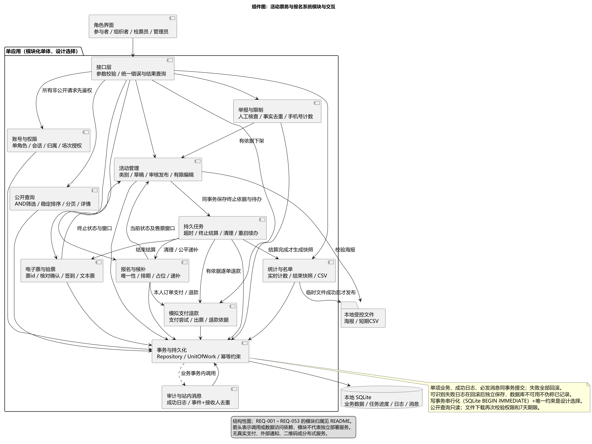

图2-1 中箭头表示调用或数据访问依赖，模块不是独立部署服务。账号权限、活动、公开查询、报名候补、模拟支付、验票、统计、治理及任务统一通过持久化边界访问数据库。审计和站内消息位于同一应用内，随单项业务加入事务。

报名服务依赖活动当前状态与时间窗口，验票服务也读取活动终止状态。举报治理模块通过活动管理执行有依据的下架，而不直接任意修改订单。活动服务提交终止状态后交由持久任务继续逐单结算，结清后才生成报表。这样同时保留即时拦截能力和可恢复批处理能力。

把公开只读查询与业务写事务分离，可减少不必要的写锁；把文件存放与下载鉴权分离，可以在持久文件仍存在时立即拒绝过期读取。图中 Repository、UnitOfWork 及 SQLite 写事务方式属于实现设计，不是已经通过验收的运行结论。
<!-- /figure-page -->

<!-- diagram-page:portrait -->
## 2.3 核心领域类图：订单、库存与票据

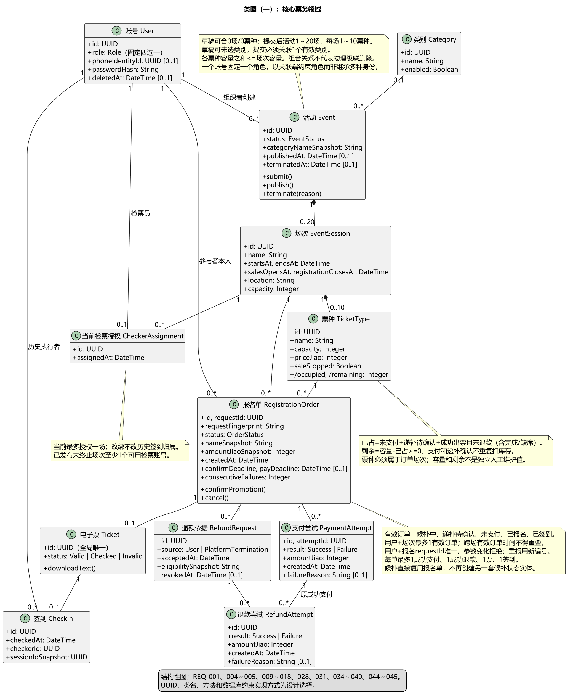

活动由一个组织者创建并关联类别，活动包含场次，场次包含票种。草稿的场次、票种和类别允许暂缺，提交后再满足完整性约束。组合关系表达领域从属，不意味着数据库可级联物理删除全部历史业务。

报名单关联一个参与者、一个场次及该场的一个票种，保存姓名和金额快照。候补直接作为订单状态存在，不再维护一份独立且可能失步的候补订单。支付尝试允许多条失败记录，但每单最多一次成功支付；退款依据与退款尝试分开，使失败重试仍能核查原申请资格。

订单最多关联一张电子票，电子票最多关联一次签到。当前检票授权与历史签到分开建模，因此改绑授权不改变既有签到的执行人和场次事实。角色采用账号固定字段而非多角色继承，符合一账号不兼任的要求。

同用户同场有效唯一、跨场时间互斥、票种属于对应场次及库存不为负由服务规则与数据库约束共同保证。姓名不是唯一键，重名用户以内部用户编号区分；手机号用于账号身份和长期限制关联。
<!-- /figure-page -->

<!-- diagram-page:landscape -->
## 2.4 支撑领域类图：治理、消息与恢复

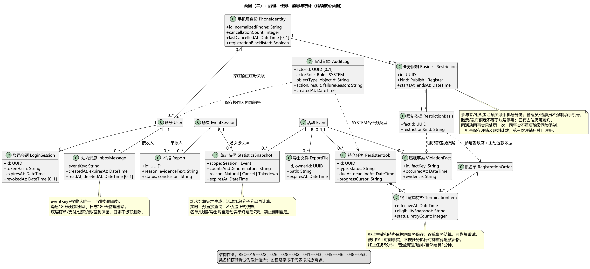

图2-3 延续核心模型，补充手机号身份、会话、举报、违规事实、限制依据、消息、日志、任务、终止待办、统计快照和导出文件。参与者与组织者必须关联手机号身份，管理员和检票账号不额外强制提供手机号。手机号身份跨注销重注册保留计数，而历史账号及业务编号保持关联。

限制单独保存触发依据，避免同一事实重复处罚；账号会话与业务报名限制分开，避免限制新报名误伤历史查询和已有占位履约。站内消息按事件和接收人唯一，审计日志保存操作人、对象、类型、结果及时间，自动行为以 SYSTEM 标识。

终止逐单待办记录生效时刻和判断事实，处理中重启也沿用原依据。统计快照和 CSV 保存读取期限，底层订单继续保留，使“短期结果过期”与“删除个人历史”互不混淆。这些拆分直接服务于恢复、审计和期限控制。
<!-- /figure-page -->

<!-- diagram-page:portrait -->
## 2.5 用例图：角色与业务入口

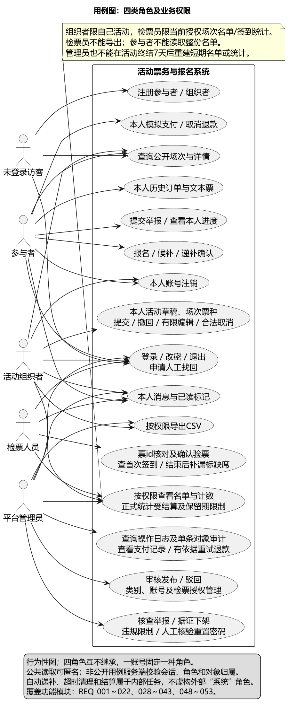

用例图将访客公开查询、参与者本人交易、组织者活动管理、检票员现场核验和管理员平台治理分开。四种账号角色互不继承，访客作为未登录访问者单独出现。自动递补与超时清理由内部任务执行，不虚构外部“系统用户”。

名单和统计是可复用功能入口，但数据范围不同：组织者限自己活动，检票员限当前授权场次及签到统计，参与者没有完整名单，管理员也不能绕过七天保留期限。CSV 导出仅向组织者和管理员开放，退款重试仅向具有合法依据的管理员操作开放。

这种划分使界面导航能够直接对应权限边界。共享组件负责一致的展示方式，服务端对象过滤负责真正的数据隔离，避免把“管理员可管理”解释为能够任意代替其他角色执行业务。
<!-- /figure-page -->

<!-- diagram-page:landscape -->
## 2.6 活动状态图：审核发布与终止

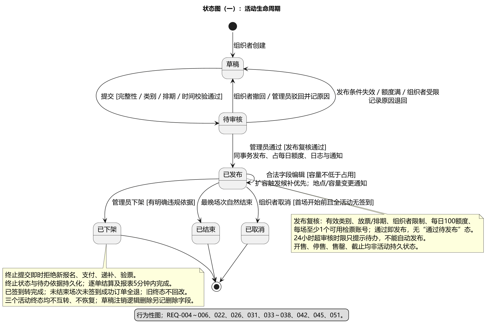

活动的持久状态为草稿、待审核、已发布、已取消、已下架和已结束。提交进入待审核，撤回或驳回回草稿，通过即发布；发布时条件失效应记录理由退草稿。开售、售罄、停售和截止是展示或下级对象派生状态，不替代活动状态。

已发布只允许受约束的编辑、自愿取消、有依据下架或自然结束。取消检查首场开始前且全活动无签到，审核超时不自动通过，三个终态不可恢复和互转。终止时保存事实并即时拦截新操作，逐单结算另有进度。

把生命周期与结算进度分开，可以表达“活动已终止，但订单仍在处理中”，不必增设会放行新交易的含糊中间态。正常结束的缺席和平台中止的退款也由各自条件处理，避免混淆责任。
<!-- /figure-page -->

<!-- diagram-page:landscape -->
## 2.7 订单状态图：候补、支付、签到与终态

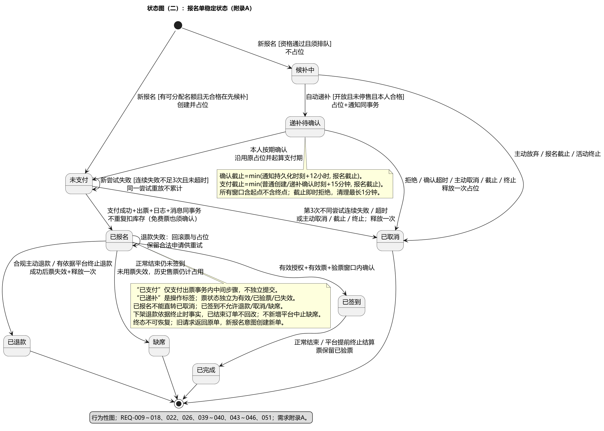

图2-6 按需求附录 A 表达稳定状态。无订单时根据名额和在先候补分别进入未支付或候补中；候补获得名额后进入递补待确认，确认后转未支付，支付出票同事务成功后才进入已报名。“已支付”只是事务内中间步骤，“已递补”只是操作记录，不独立持久化为稳定状态。

已报名可通过授权验票进入已签到，通过合法退款进入已退款，或在自然结束未签到时进入缺席；已签到在结算时变已完成。已报名不能直接变已取消，已签到不能变退款、取消或缺席；已取消、已退款、已完成和缺席均不恢复。重新报名是新请求创建新单。

图中的自环表示一次失败后状态仍不变。相同支付尝试重放不累计失败，第三次不同连续失败或超时才取消占位。退款失败维持原票和占位，成功退款才失效并释放一次。这使界面状态、库存口径和重试行为保持一致。
<!-- /figure-page -->

<!-- diagram-page:portrait -->
## 2.8 报名支付时序图：原子占位与结果查询

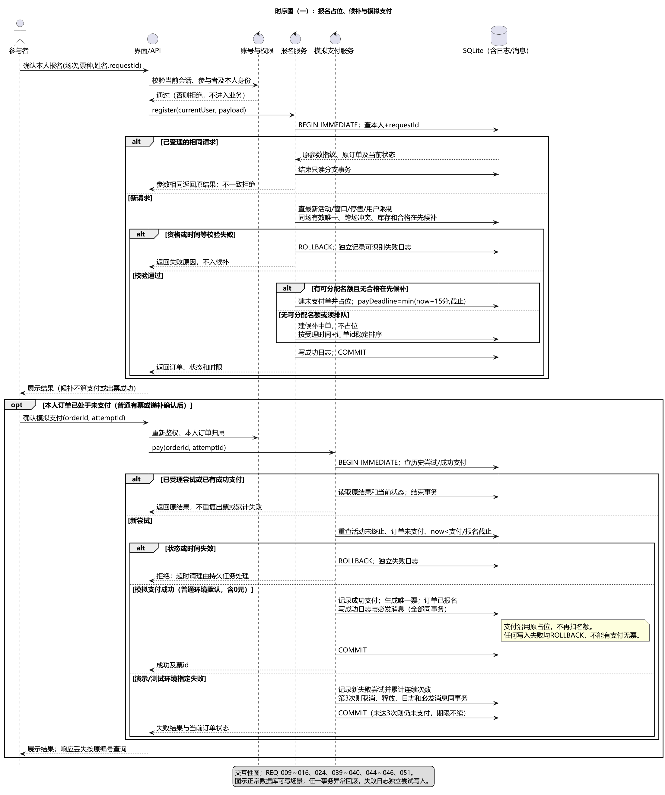

接口取得当前账号身份后，将报名交给服务处理。事务先检查本人请求编号是否已受理：参数相同返回原订单及当前状态，参数不同则拒绝。新请求再检查最新活动、时间、用户限制、有效唯一、排期、库存和合格候补，然后创建订单与日志。资格失败不入候补。

支付作为另一次由用户发起的业务请求执行。服务先检查历史尝试和已成功支付，再对新尝试复核订单及截止；成功支付、生成唯一票、订单状态、成功日志和必发消息一并提交。确认报名只创建未支付订单并导航支付页，页面跳转本身不构成支付成功。

将报名和支付拆为两个明确动作，既满足交互要求，也使占位与付款职责清楚。事务内处理一项业务，响应丢失后查询既有结果，不依赖客户端重复创建。演示失败开关不进入普通购票界面。
<!-- /figure-page -->

<!-- diagram-page:portrait -->
## 2.9 验票与终止时序图：二次检查与并发顺序

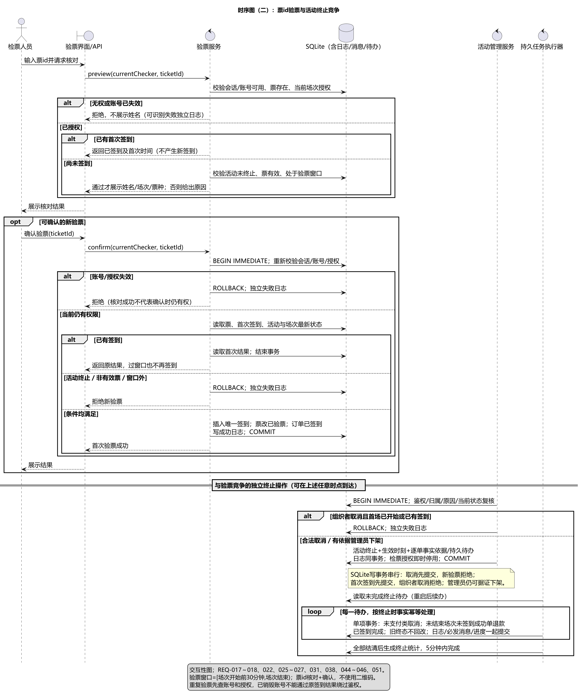

票 id 核对先验证账号、票存在性和当前场次授权；满足条件才展示姓名、场次和票档。用户点击确认后开启写事务，再查账号、授权、首次签到及活动状态。已签到且账号仍有效授权时返回首次结果，不在窗口外新增签到；账号失效则优先拒绝。

取消和首次签到使用一致的事务边界竞争。取消先提交则新验票拒绝；签到先提交则组织者取消条件不成立。管理员仍可基于证据下架，后续按终止时保存的事实逐单结算，不把任务执行时间当成退款资格判断时点。

时序图下半部表示可在任意时点到达的独立终止操作，而不是要求先完成一次验票再取消。这样的设计说明了核对页面不能长期持有授权承诺，写入前必须再次检查，也说明了终止处理应使用可恢复任务而不是一个全活动长事务。
<!-- /figure-page -->

<!-- pagebreak -->

# 3 各功能模块的 UI 界面与功能说明

## 3.1 视觉规范与页面组织

界面以购票平台常见的信息组织方式为参照，采用低饱和莫兰迪配色：米白背景、灰玫瑰主操作、鼠尾草绿状态提示，正文使用深灰保证阅读。参与者页面强调活动海报、场次票档和本人信息；管理页面使用固定侧栏、表格及分区表单，保持同一套按钮、圆角和留白。

| 设计项 | 采用方案 | 功能作用 |
| --- | --- | --- |
| 页面背景与面板 | 背景 #F6F4F0，面板 #FFFEFC，边框 #DFDED8 | 通过轻微层次分离内容，减少装饰干扰 |
| 主操作色 | 灰玫瑰 #A97773，选中项使用浅同色背景 | 突出报名、支付、保存、审核等当前主要动作 |
| 状态提示 | 鼠尾草绿 #7C8C7C，浅绿背景；注意事项采用浅米黄 | 状态同时配文字，避免只依靠颜色区分 |
| 文字与布局 | 深灰正文、衬线标题、桌面宽1440，长页面完整导出 | 保持信息层级与各角色页面一致性 |
| 关键交互 | 报名和支付分页；验票先核对再确认；退款有确认区域 | 清楚区分创建订单、支付、签到和资金结果 |

以下展示 28 张模块界面。一个页面可以展示同一模块的不同状态示例，如候补与递补、实时计数与正式快照；这些示例不代表同一订单同时具有多种状态。名单、统计、消息等共用组件按不同角色加载授权数据，不允许实际跨角色读取私人内容。

界面由 Figma 建立可编辑画板，最终 PNG 采用同源设计脚本在本地渲染。当前正常导航原型验证了“确认报名到支付页”和“确认模拟支付到电子票页”，不等于已经实现后端交易。图中的名字、手机号、金额、时间和计数均为演示数据。

<!-- ui-page -->
## 3.2 登录与人工找回入口

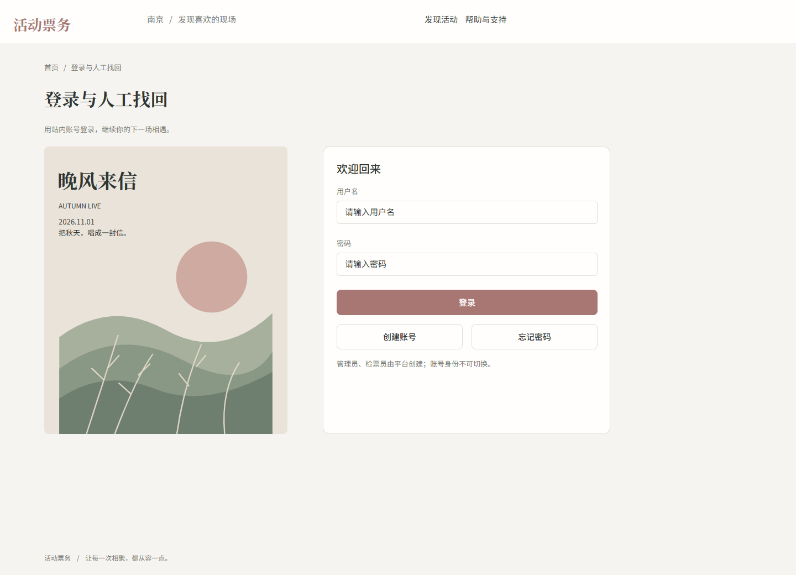

登录页以海报和登录表单双栏组织，填写站内用户名与密码，提供“创建账号”和“忘记密码”入口。登录后由账号固定角色决定进入参与者页或相应工作台，不提供身份切换。

功能对应 REQ-028 至 030。未登录可浏览公开活动，但不能报名、读取订单或名单。会话到期、另一端登录、改密或停用后，旧会话应失效；凭据错误停留原页并提示原因。
<!-- /figure-page -->

<!-- ui-page -->
## 3.3 注册账号

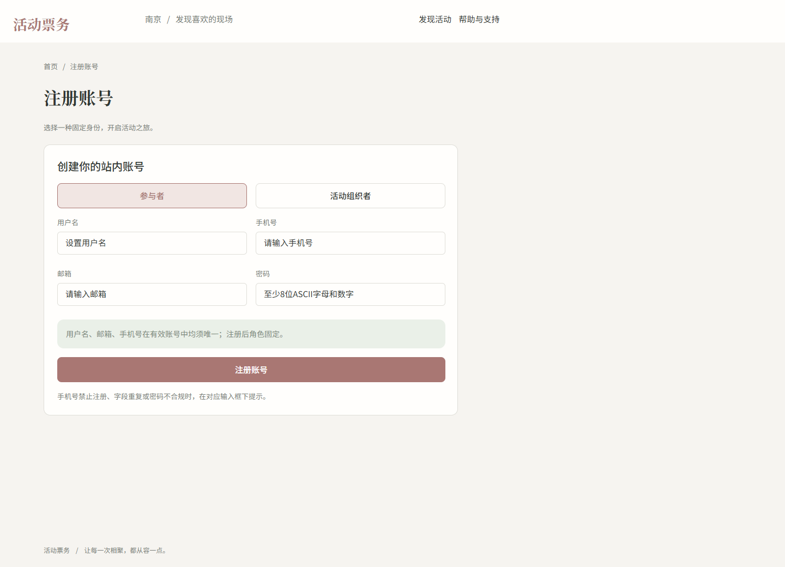

注册页收集用户名、邮箱、手机号和密码，仅允许选择参与者或活动组织者。角色在创建后固定，管理员与检票员不通过此入口注册。

功能对应 REQ-001、028、032。有效账号的用户名、邮箱、手机号分别全局唯一，密码至少八位且包含 ASCII 字母和数字。重复字段、非法密码或手机号注册限制应定位到对应输入项提示，不把姓名重名当成注册失败条件。
<!-- /figure-page -->

<!-- ui-page -->
## 3.4 发现活动与多条件查询

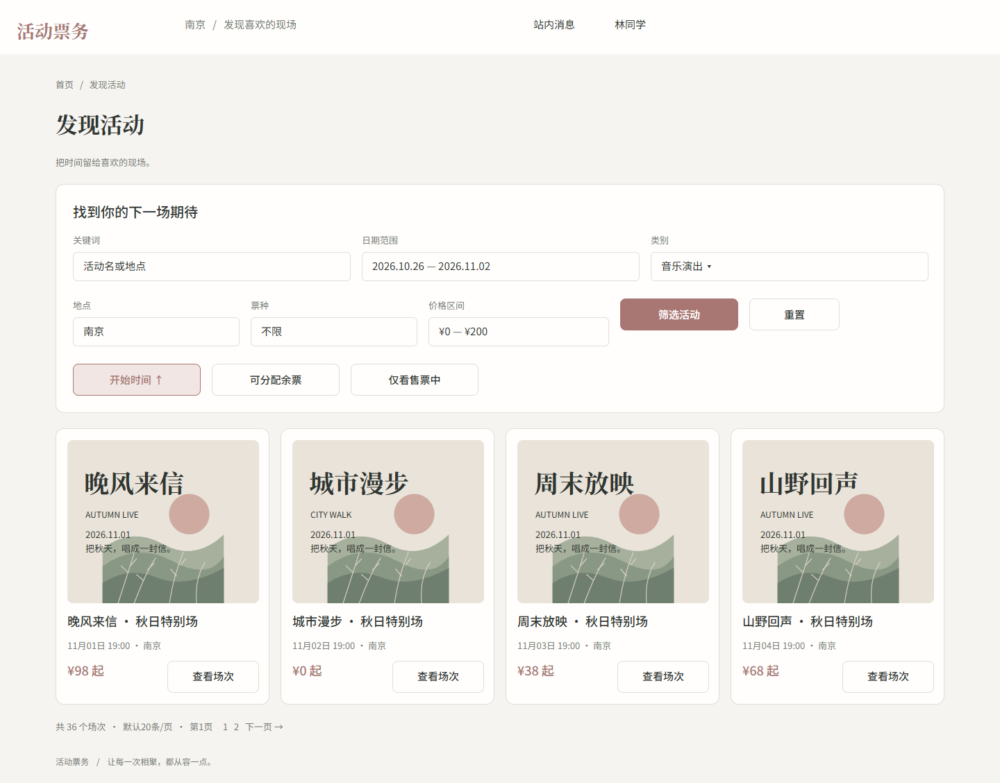

页面按“筛选区、排序区、场次卡片、分页”组织。用户可同时指定关键词、日期、类别、地点、票种、价格和售票状态，卡片显示活动、场次时间、地点和起价，并进入详情选择票档。

功能对应 REQ-007、008、030、050。结果以场次为行，条件取 AND；价格和名称需由同一票种满足。公共列表过滤不可公开活动及已结束场次，排序同值以场次编号稳定处理，深分页超限时引导缩小范围。示例卡片只显示一个代表性场次。
<!-- /figure-page -->

<!-- ui-page -->
## 3.5 活动详情与本人报名

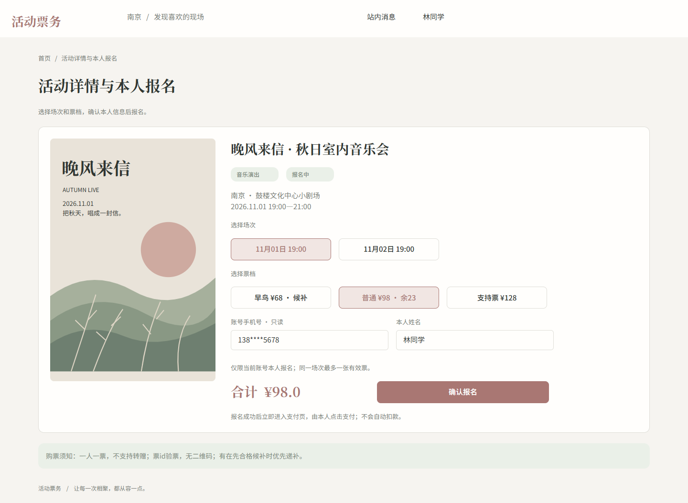

左侧海报建立活动识别，右侧依次展示时间地点、场次、票档及本人信息。手机号来自当前账号，脱敏只读；姓名填写或确认后作为本单快照。没有购票数量、多观演人或转赠入口，同用户同场最多一有效单。

功能对应 REQ-009、014、027、039、050。点击“确认报名”且服务端受理普通有票订单后立即跳转支付页；需要排队则进入候补页，失败则提示原因。姓名允许重名，订单归属依靠用户编号而不是姓名；界面限制不构成实名认证。
<!-- /figure-page -->

<!-- ui-page -->
## 3.6 独立订单支付页

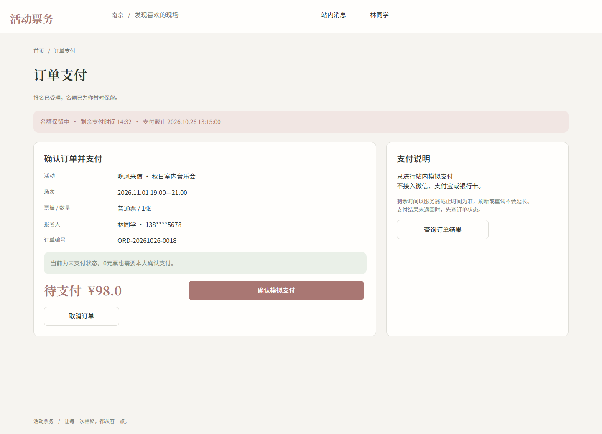

支付页显示未支付订单摘要、报名人、金额、截止时刻与剩余时间，强调名额只是暂时保留。用户点击“确认模拟支付”后才发起付款与出票；也可取消订单，或在网络结果不明确时查询订单。

功能对应 REQ-009 至 012、045、046。免费票也需确认；刷新和重试不续期，截止由服务器判断。已受理请求重放返回既有结果，成功后进入电子票页，失败则显示当前状态，不能因跳转或按钮点击直接伪造已支付。
<!-- /figure-page -->

<!-- ui-page -->
## 3.7 报名成功与电子票

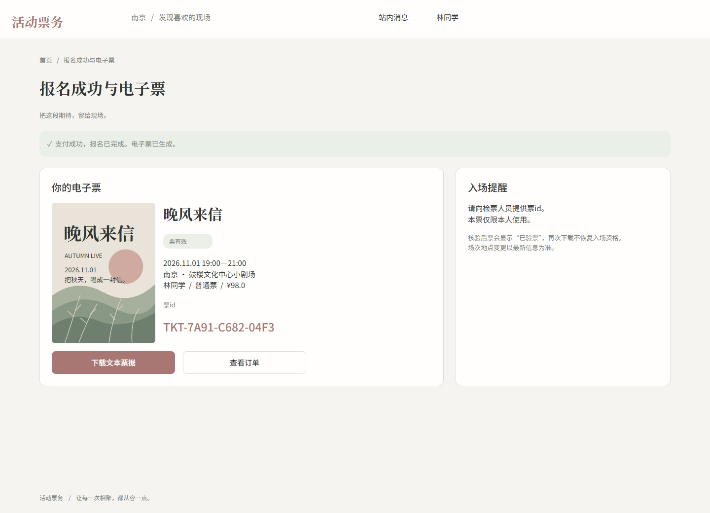

支付出票提交成功后展示电子票、唯一票 id、姓名、场次、地点、票档、实付价和票状态，提供下载文本票据及查看订单入口。页面不展示二维码，也不提供转赠。

功能对应 REQ-010、017、040。票据使用报名姓名和金额快照，地点取最新场次信息；票已失效或已验票时必须明确标识不可再次验票。下载和重复查看不改变票状态，并且每次都校验本人归属。
<!-- /figure-page -->

<!-- ui-page -->
## 3.8 我的订单与退款确认

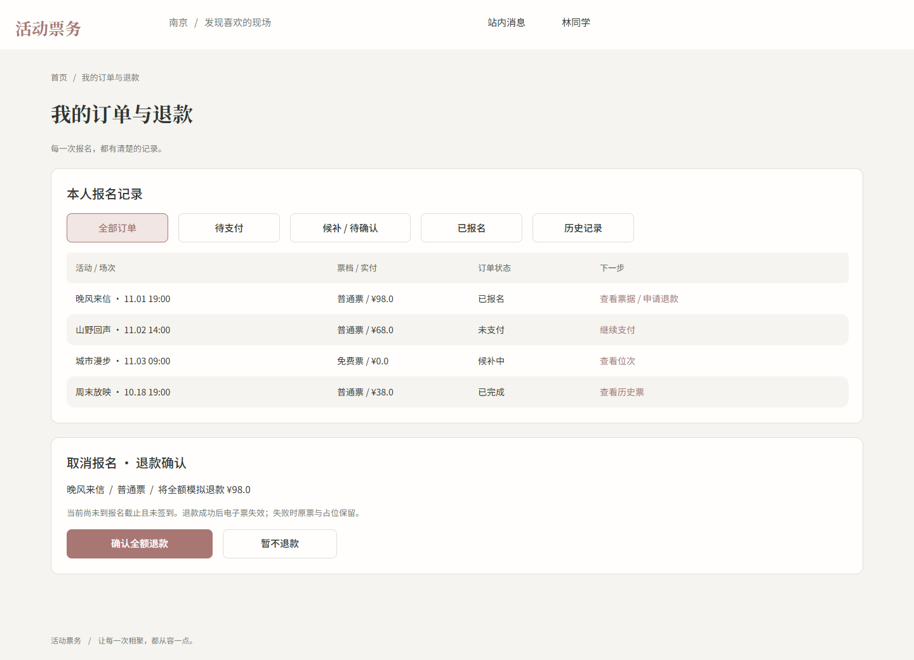

订单列表通过状态分类呈现本人当前待办及历史记录，提供继续支付、查看票据、候补位次及合法退款入口。下方退款确认区域展示对象和全额退款金额，避免将取消未支付与退款已报名混为一个动作。

功能对应 REQ-003、010、015、040。已签到、已完成、缺席或截止后的新主动退款应禁用并说明原因；失败时保留原票及占位，成功才使票失效、释放一次库存。终态历史仍可查看，不允许恢复原订单。
<!-- /figure-page -->

<!-- ui-page -->
## 3.9 候补与递补确认

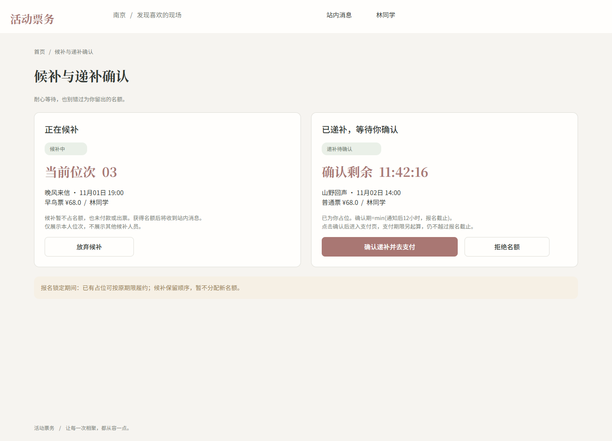

页面并列展示两个不同订单的状态示例。候补中仅显示本人位次，说明尚未占位、付款或出票；递补待确认显示已占名额、确认倒计时，以及“确认递补并去支付”和拒绝入口。

功能对应 REQ-011 至 014、043、051。先确认再支付，两段期限分别起算且均截断至报名截止。锁定期间已有占位可以履约，未占位候补保留队列顺序但暂跳过新分配。实际支付页应携带确认后的原订单，不能另建普通订单。
<!-- /figure-page -->

<!-- ui-page -->
## 3.10 站内消息

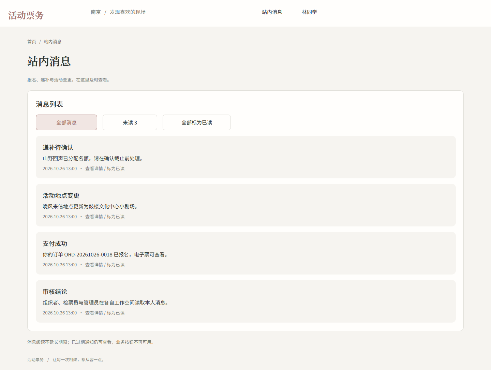

消息列表区分全部和未读，支持查看详情及已读标记。递补、支付、退款、审核、活动变更、终止和限制等消息使用同类组件，进入相应业务详情时继续校验当前权限和状态。

功能对应 REQ-051、052。本图为参与者视图，其他角色只加载各自接收的消息；消息展示中的内容样例不是给参与者开放组织者审核操作。阅读不延长确认期限，过期消息不再提供可执行待办；消息生成后180天逻辑删除。
<!-- /figure-page -->

<!-- ui-page -->
## 3.11 个人中心与账号安全

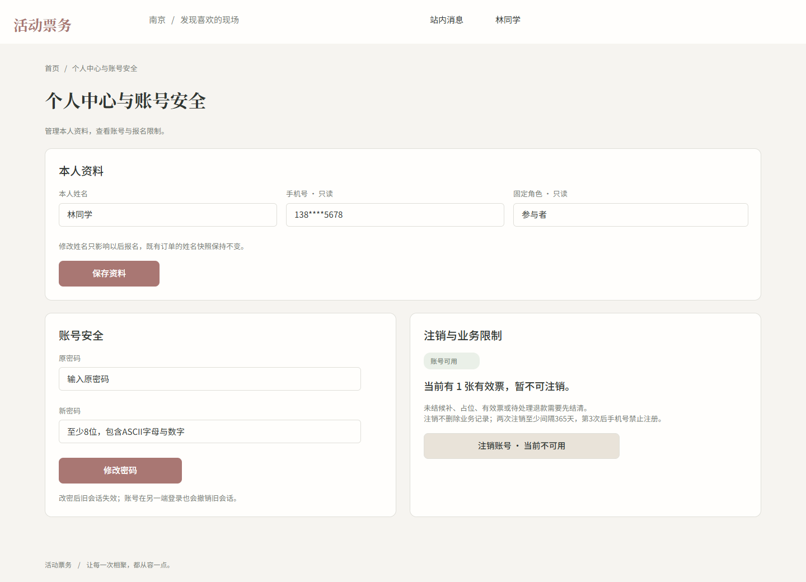

页面将本人资料、账号安全和注销资格分区。手机号只读，姓名修改仅影响以后报名；改密需原密码，完成后撤销旧会话。注销区域直接显示当前有效票或未结业务导致的不可注销原因。

功能对应 REQ-028、029、032、039、043。注销检查有效候补、占位、票和退款，组织者还需检查待审或未结束活动。注销与长期手机号计数、黑名单分开处理，不删除历史业务。角色复用安全组件时仍按本人账号检查。
<!-- /figure-page -->

<!-- ui-page -->
## 3.12 活动举报与本人进度

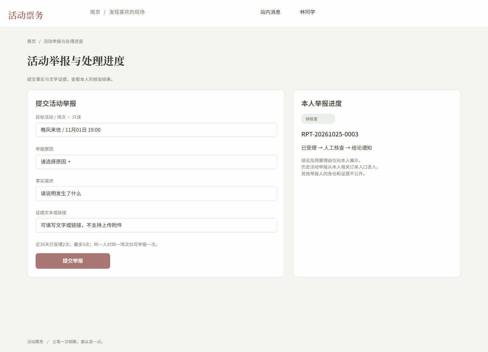

举报表单明确目标活动及场次，收集原因、事实描述及文字证据或链接，旁侧展示本人举报编号、受理状态和结论进度。不提供附件上传或自动抓取证据功能。

功能对应 REQ-008、041、042。同人同场最多一次，连续30天内最多5次受理，驳回不返次数。终态活动从本人相关历史订单进入，其他举报人的身份与证据不公开；购票锁定不直接禁止举报。
<!-- /figure-page -->

<!-- ui-page -->
## 3.13 组织者活动工作台

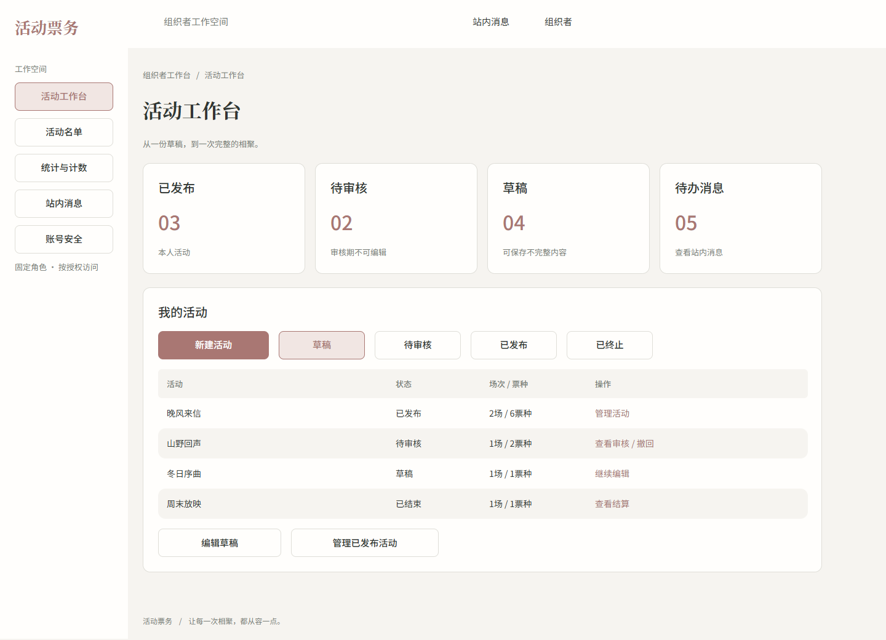

工作台概括本人已发布、待审核、草稿和消息数量，列表按活动状态给出新建、继续编辑、撤回审核、已发布管理和结算查看等操作入口。

功能对应 REQ-004 至 006、037、038、053。所有列表仅属于当前组织者；待审核不允许编辑，撤回需与管理员审核并发竞争。终态活动只读，不提供恢复发布入口。
<!-- /figure-page -->

<!-- ui-page -->
## 3.14 草稿与场次票种编辑

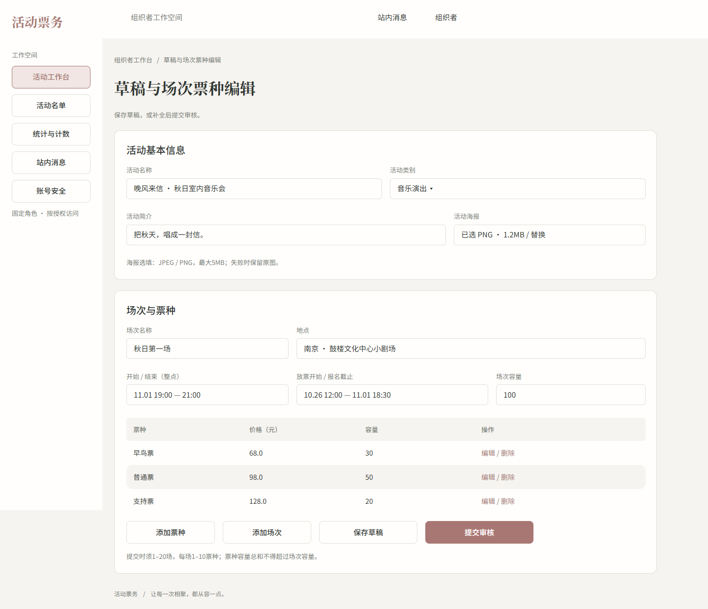

编辑页分活动基础信息、场次和票种三层，填写类别、简介海报、时间地点、独立放票窗口、容量和价格。“保存草稿”允许暂不完整，“提交审核”检查完整性、结构和排期；添加票种与场次分别放在对应区域。

功能对应 REQ-005、033 至 036。容量为1至9999整数，票种容量之和不超过场次容量；价格最多一位小数、内部用整数角保存。场次时间非整点应先展示截断结果供确认。海报JPEG/PNG不超过5MB，替换失败保留原图。
<!-- /figure-page -->

<!-- ui-page -->
## 3.15 已发布活动管理与取消

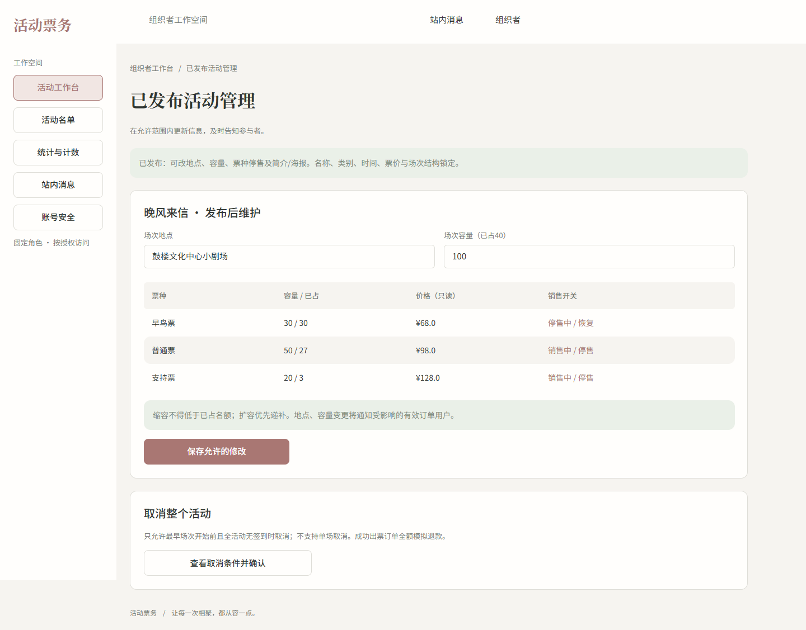

页面明确标示可编辑的地点、容量、停售、简介和海报，以及被锁定的名称、类别、时间和价格。票种表同时展示容量与已占，保存时整体校验。取消整个活动放在独立区域，避免与日常编辑混用。

功能对应 REQ-022、038、044、051。缩容不可低于占用，扩容优先递补；地点和容量变更通知有效订单用户。组织者只能在首场开始前且全活动没有签到时取消，不支持单场取消，也不能下架后修改再恢复。
<!-- /figure-page -->

<!-- ui-page -->
## 3.16 活动名单与 CSV 导出

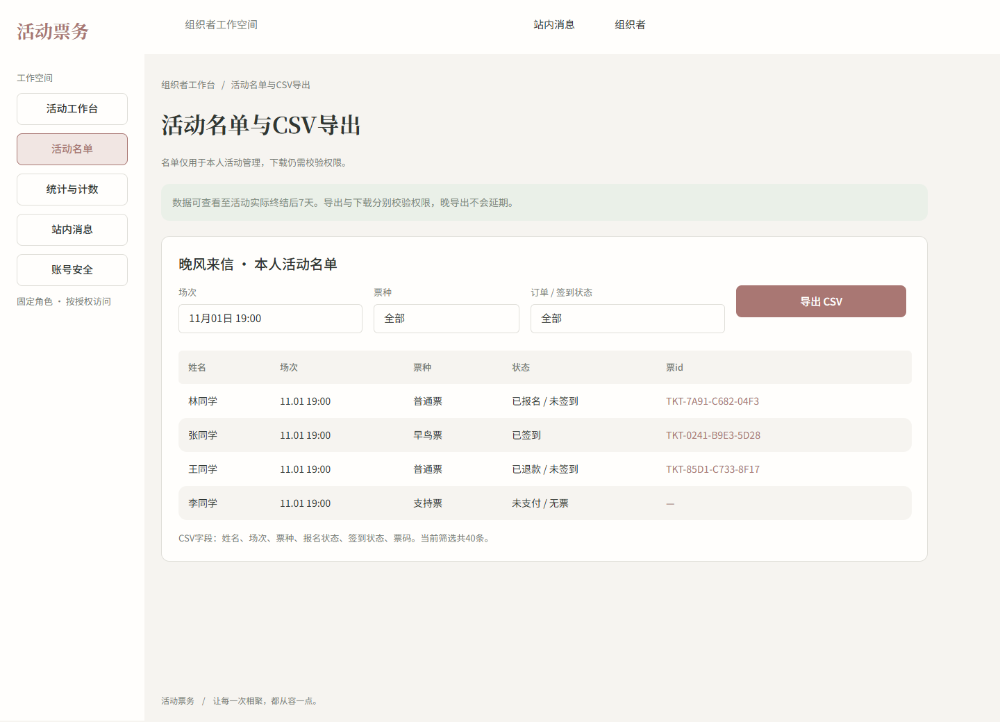

名单展示姓名、场次、票种、订单与签到状态及票 id，可按场次、票种和状态筛选。组织者可导出本人活动 CSV，空结果输出表头并说明零条记录，生成失败不能发布半文件。

功能对应 REQ-020、048、052。检票员复用名单组件时只看授权场次并隐藏导出；管理员也受期限限制。CSV 使用 UTF-8 BOM，处理特殊字符和文本公式起始符。生成、下载均检查权限及整活动终结后七天期限，晚导出不延期。
<!-- /figure-page -->

<!-- ui-page -->
## 3.17 统计与实时计数

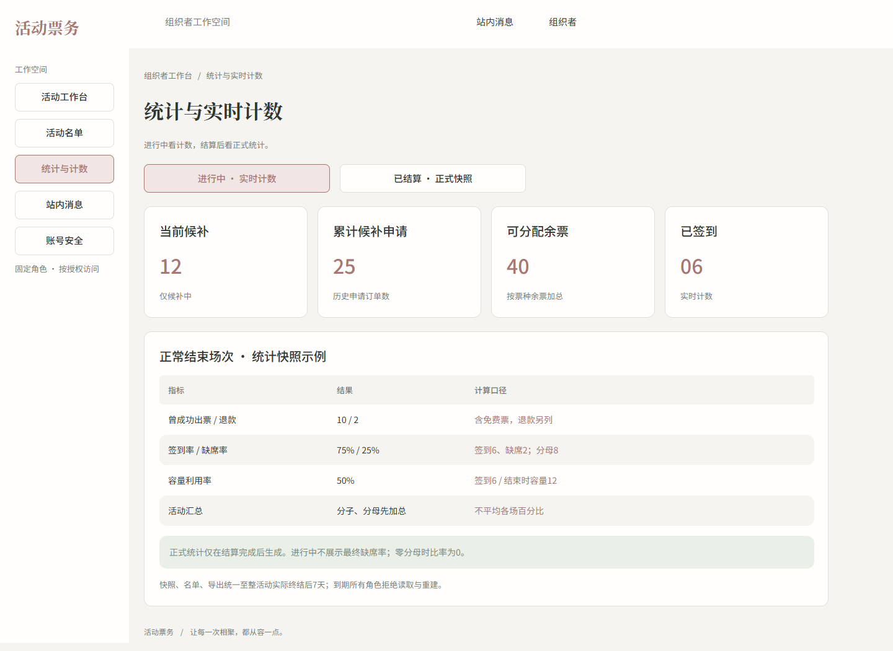

页面区分进行中的实时计数与已结算正式快照。上方展示当前候补、累计候补、余票和签到数，下方用已结束示例说明曾出票、退款、签到率、缺席率和容量利用率口径。

功能对应 REQ-019、049、052、053。进行中不生成最终缺席率，正式快照等待结算完成。示例出票10、退款2、签到6、缺席2、容量12，得到75%签到率、25%缺席率和50%利用率；活动汇总先加总分子分母，零分母比率为0。
<!-- /figure-page -->

<!-- ui-page -->
## 3.18 检票员授权场次核对

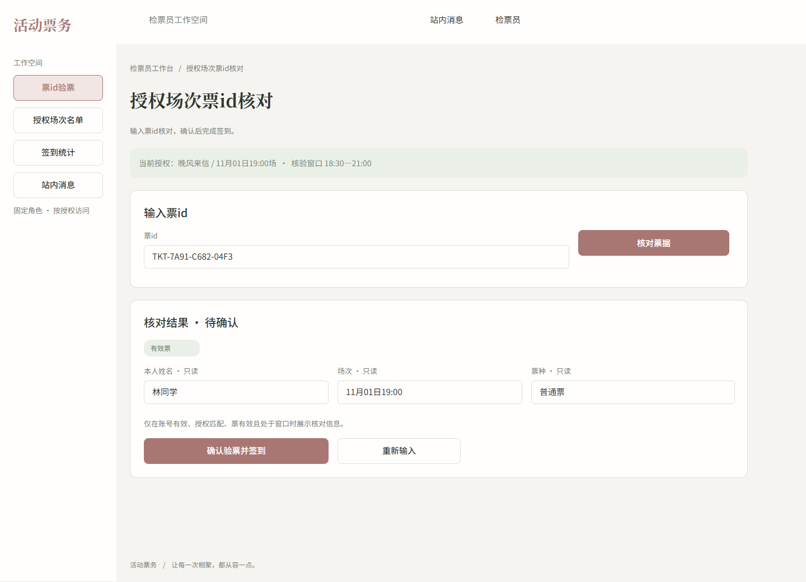

页首固定展示当前授权场次及验票窗口。检票员输入票 id 点击核对，通过后才显示姓名、场次、票档和有效状态；再次确认才正式签到，满足核对到确认不超过两次操作的目标。

功能对应 REQ-017、027、031、048、049。确认时重新鉴权并检查最新状态；跨场、账号失效或授权撤销不得泄露姓名。页面不用二维码，票号唯一不替代授权校验。当前图展示的是成功核对后的状态。
<!-- /figure-page -->

<!-- ui-page -->
## 3.19 签到结果与结束补漏

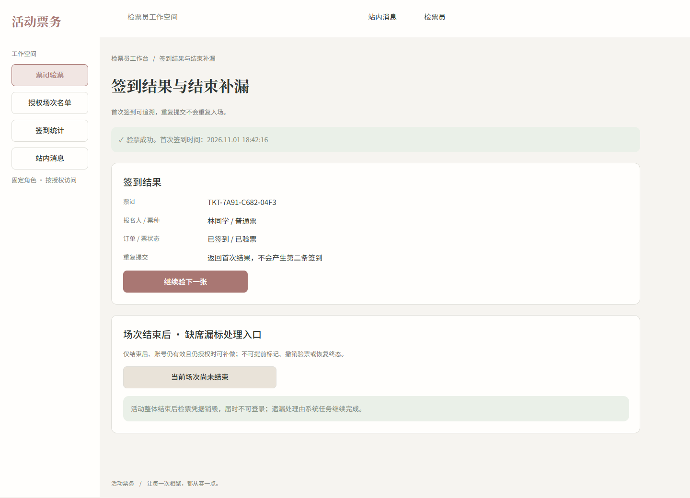

成功页显示首次签到时间、票 id、报名人及订单和票状态，提供继续核验入口。结束后的缺席漏标单独设置区域，未结束时禁用并说明条件。

功能对应 REQ-017、018、031。重复提交只返回首次结果，不能再次签到或撤销验票。补漏仅限场次已结束、账号仍有效且仍授权时使用；活动整体结束销毁检票凭据后不再登录，由持久任务继续必要结算。
<!-- /figure-page -->

<!-- ui-page -->
## 3.20 管理员活动审核发布

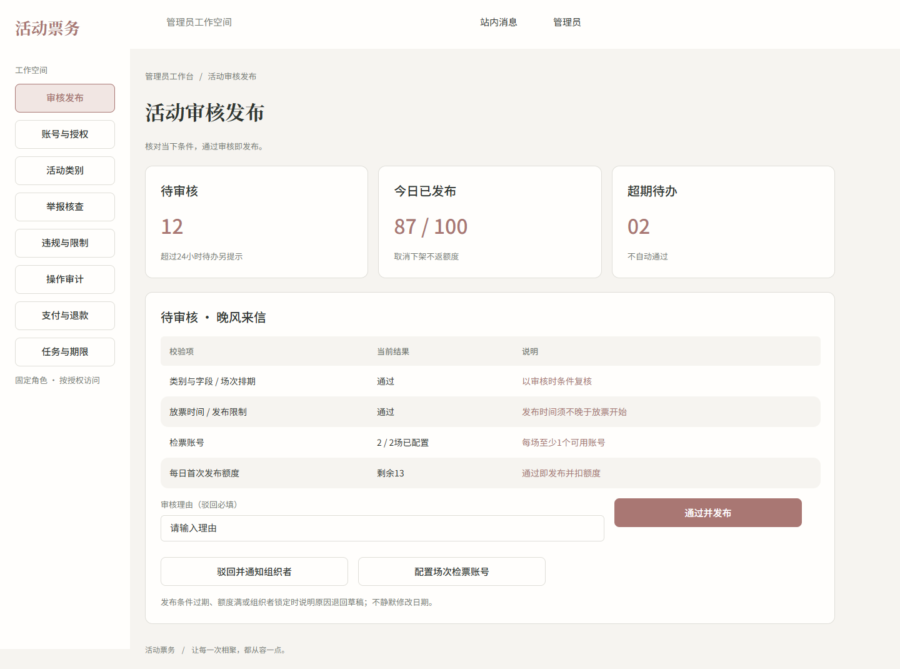

页面展示待审数量、今日首次发布额度和超期待办，审核区列出类别字段、排期、放票时间、组织者限制及每场检票账号检查结果。管理员填写审核理由并选择通过发布或驳回，另有授权配置入口。

功能对应 REQ-006、031、033、035至037。通过与发布同事务完成，每日最多100个首次发布，取消下架不返额。驳回必填理由；超24小时不自动通过；当前条件失效应说明原因退草稿，不能静默修改开售时间。
<!-- /figure-page -->

<!-- ui-page -->
## 3.21 账号与检票授权管理

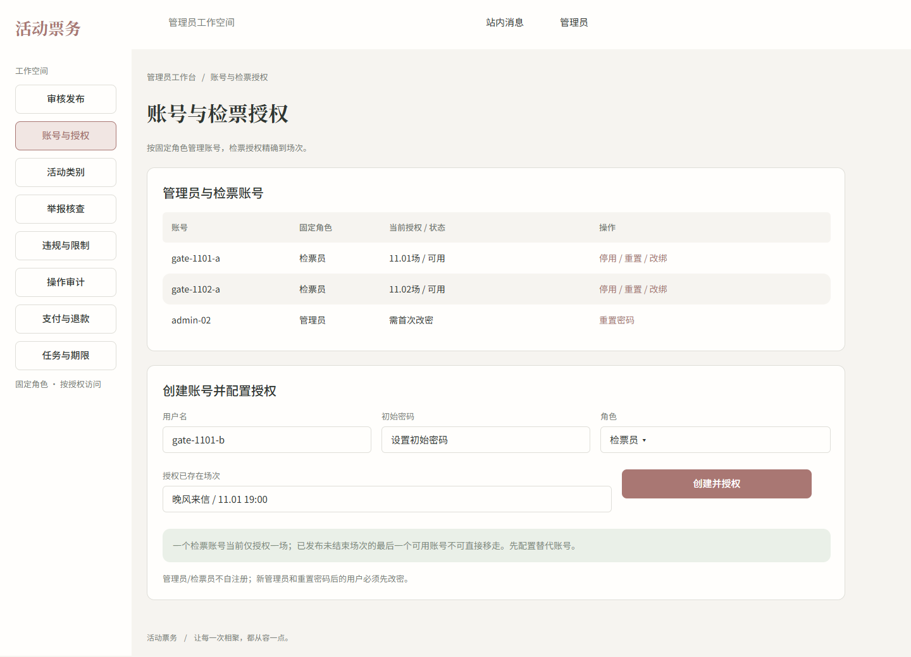

列表显示管理员、检票账号的角色、授权场次与可用状态，提供停用、重置和改绑等入口。创建检票账号时绑定已存在场次，新增管理员与密码重置后的账号进入强制改密流程。

功能对应 REQ-028、029、031。一个检票账号当前只授权一场，同场允许多个；已发布未结束场次最后一个可用账号必须先替换再移走。授权改绑不回改历史签到，终止活动按停用和逻辑删除规则处理。
<!-- /figure-page -->

<!-- ui-page -->
## 3.22 活动类别管理

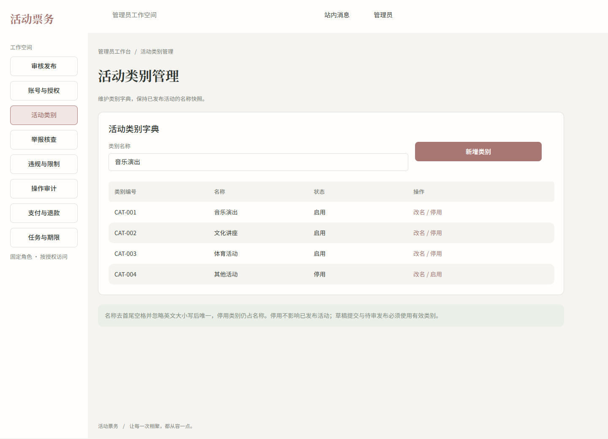

管理员通过名称输入和类别列表新增、改名、启停类别。类别编号保持稳定，列表标示状态，并提示停用对草稿、待审核和已发布活动的不同影响。

功能对应 REQ-033。名称规范化后唯一，停用类别仍占用名称；草稿提交及审核发布必须使用有效类别。类别改名不回改已发布活动名称快照，查询仍按编号关联。
<!-- /figure-page -->

<!-- ui-page -->
## 3.23 举报核查与有依据下架

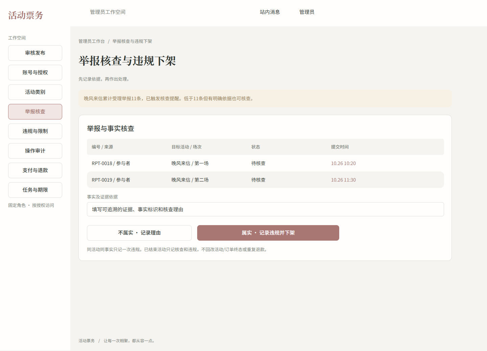

页面汇总活动下场次举报，在累计受理11条时提醒核查，列表保留来源和受理时间。管理员填写可追溯事实及证据依据，再选择不属实或属实处理；没有达到提醒阈值但有明确依据也可核查。

功能对应 REQ-022、041、042。同活动同事实只计一次违规，仍已发布且核查属实才下架。已终态活动只记录核查和违规，不回改状态或重复退款。举报内容和身份不向无权限人员公开。
<!-- /figure-page -->

<!-- ui-page -->
## 3.24 违规与报名限制

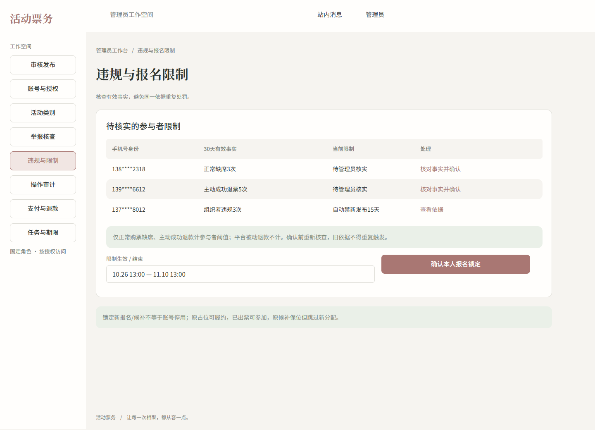

列表按手机号身份显示连续30天有效事实、当前限制和处理动作。参与者正常购票缺席达3次或主动成功退款达5次，由管理员重新核实后锁定新报名15天；组织者违规达3次自动禁新发布15天。

功能对应 REQ-032、043。平台被动退款、候补放弃、未支付取消等不计参与者阈值；零元主动成功退款仍计一次。再次限制只用上次生效后的新事实，既有占位继续按时履约，不能把业务限制当作账号停用。
<!-- /figure-page -->

<!-- ui-page -->
## 3.25 操作日志与单条对象审计

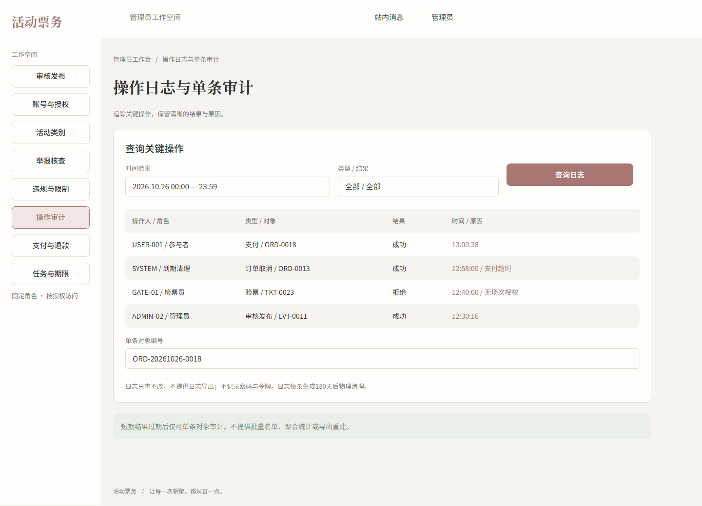

管理员可按时间、类型、对象和结果查询关键日志，区分人工与 SYSTEM 自动任务，查看失败原因，并以单条业务编号追踪订单及相关记录。界面不提供人工修改、删除或日志导出。

功能对应 REQ-021、025、045、052。日志不保存密码或令牌，生成后180天物理清理。短期名单和统计过期后，单条审计入口仍不得提供批量名单、聚合统计或导出重建；数据库不可写时不能伪称已记录失败日志。
<!-- /figure-page -->

<!-- ui-page -->
## 3.26 支付记录与有依据退款重试

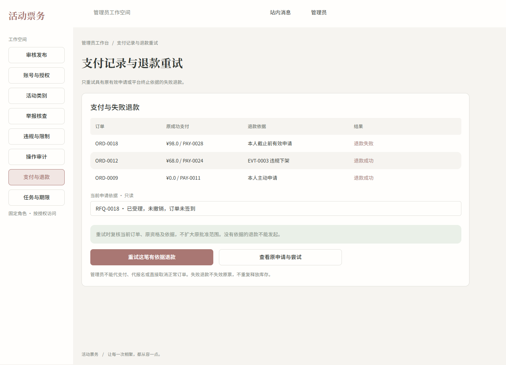

列表将原成功支付、退款依据和结果并列，失败项可查看原受理申请，再发起有依据的重试。零元支付与退款也保存记录，不能只凭失败页面当作管理员退款授权。

功能对应 REQ-003、015、045。重试检查申请未撤销、原资格和当前订单状态，不扩大原批准范围；原申请虽早于截止，已签到等当前禁止状态仍须拒绝。失败不重复释放库存，成功最多一次；管理员不具备代支付入口。
<!-- /figure-page -->

<!-- ui-page -->
## 3.27 终止结算任务与数据期限

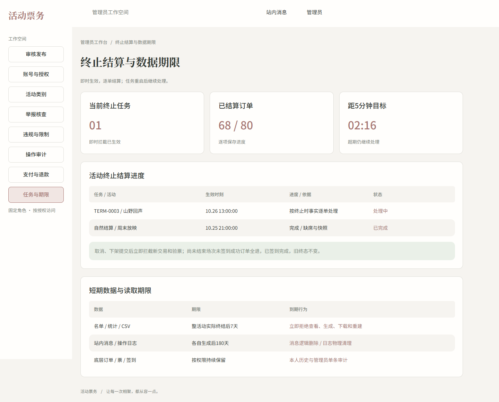

任务页区分“终止已生效”和“存量订单处理中”，展示待办进度、原生效时间及结算目标。下方分别列出名单统计CSV、消息日志和底层订单票据的不同保留方式。

功能对应 REQ-022、026、046、052。终止后即时拦截新交易和验票，逐单幂等并保存进度，重启使用原终止事实继续；超5分钟仍继续处理但记录未达标。到七天边界即拒绝短期读取和重建，不等待清理任务完成，也不删除本人历史票。
<!-- /figure-page -->

<!-- ui-page -->
## 3.28 边界与异常反馈

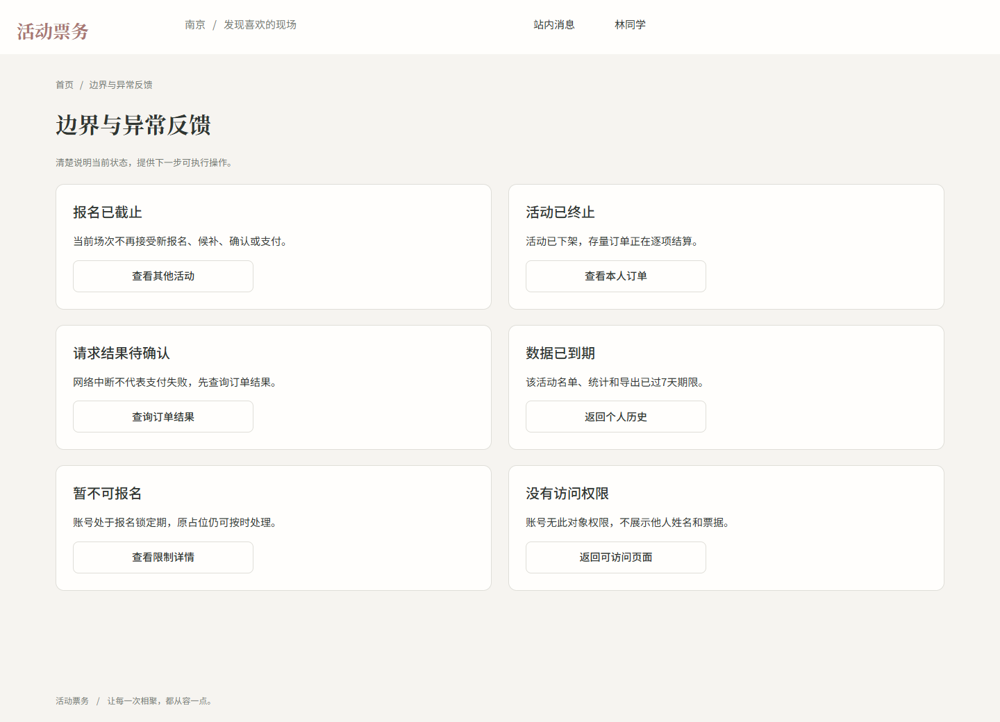

页面汇集报名截止、活动终止、网络结果未知、数据过期、报名锁定和无权限六种反馈示例，每种状态都给出原因及可执行下一步，如查本人订单、查询支付结果或返回可见活动。

功能对应 REQ-008、011、012、025、043、046、052。这些是不同入口的状态组件示例，不是要求所有异常同时发生。404只用于资源不存在；越权不得展示他人信息，旧页面也必须重新校验截止和终止状态。
<!-- /figure-page -->

<!-- ui-page -->
## 3.29 人工找回与首次强制改密

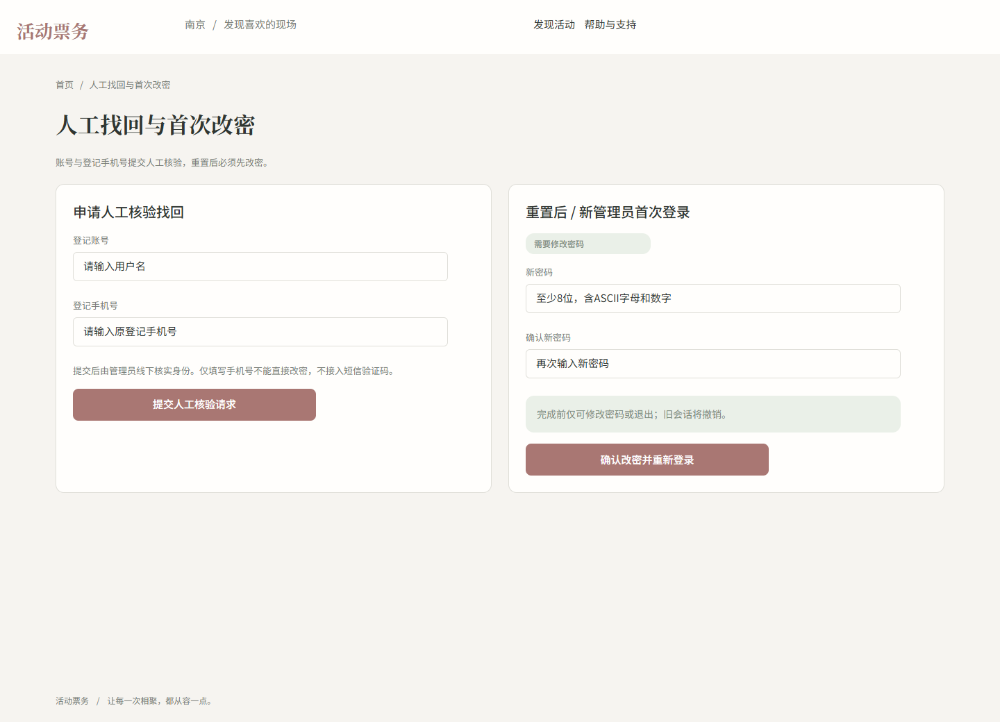

页面展示找回申请和强制改密两个流程状态。找回填写登记账号与手机号，提交管理员线下核验，不允许只凭手机号自助重置。重置后及新管理员首次登录，必须设置符合规则的新密码。

功能对应 REQ-028、029、031。改密前仅开放改密、退出等必要会话操作，完成后撤销旧会话并重新登录；不接真实验证码。图中两栏为不同状态的设计展示，实际流程按账号所处状态进入对应区域。
<!-- /figure-page -->

<!-- pagebreak -->

# 4 辅助工具交互、修改优化与设计反思

## 4.1 记录方式与使用范围

本次使用 Codex 辅助梳理需求、组织UML、提出界面方案、构建设计文件及整理文档；imagegen用于首张购票页面的风格预览。PlantUML、Figma、本地浏览器和PDF工具分别承担图形渲染、可编辑界面、截图导航验证和文档导出。
交互采用逐步扩展方式：先给出需求基线，生成可以审阅的局部结果，核对规则后再扩展。。

## 4.2 记录一：需求梳理与 UML 方案

**使用场景与任务摘要。** 实验一已经形成53条需求，需要将分散的角色、状态、库存和异常规则转为模块及不同UML视图。任务要求同时满足实验二的图形类别要求，说明各视图负责表达什么。

**生成结果。** 形成组件图、核心类图、支撑类图、用例图、活动状态图、订单状态图及两张时序图，共8张、5种类型。组件图说明模块依赖，类图说明对象，状态图说明允许转换，时序图说明跨模块操作。

**设计判断与优缺点。** 辅助工具的优势是快速整理长需求并建立视图分工；局限是可能把对象罗列当成架构，或按一般购票平台补入真实支付、二维码等本项目排除项。设计判断是先检查业务闭环与需求覆盖，再看图的数量，而不是把满足数量当作完成建模。

**修改优化与结果。** 以需求附录的状态清单和不变量核对图形，补充单角色、候补优先、退款依据和读取期限等注释；将单体、SQLite与事务方案标为设计选择。最终保留8份可修改的PlantUML源文件和对应PNG，分别标明类型与需求范围。

## 4.3 记录二：对象关系、状态与例外复核

**使用场景与任务摘要。** 初步模型需要进一步检查草稿完整性、账号手机号、当前授权、历史签到及订单状态等边界，防止图中的统一表达覆盖了需求例外。

**生成结果。** 报名单统一承载候补和交易状态，另设支付尝试、退款依据、退款尝试、电子票及签到；“已支付”只作为事务内步骤，不提交为稳定状态，“已递补”不额外建状态。当前检票授权与历史签到分别保存。

**设计判断与优缺点。** 优势是模型能够集中展示跨条目的关联，便于发现重复状态或缺失路径；局限是容易把所有对象都按同一完整性标准处理。例如草稿尚未选类别、管理员或检票账号不填手机号，都不能简单按完整参与者账号判断。生成后的自动检查也不能冒充使用者已经完成的人工复核。

**修改优化与结果。** 复核后允许草稿类别暂缺、提交时再要求有效类别；手机号身份只对参与者和组织者强制，补上组织者公开查询用例。保留姓名可重名、按用户编号关联订单、已签到不可退款和终态不可恢复等规则，使类图、状态图与时序图口径一致。这些是本次生成过程的自检修正。

## 4.4 记录三：单页视觉风格探索

**使用场景与任务摘要。** 在扩展全部界面之前，先以一张桌面购票页面比较布局、配色和信息层级。视觉参考购票平台常见结构，同时要求低饱和、简洁和莫兰迪配色。

**生成结果。** imagegen生成左海报、右场次票档及报名区的预览，采用米白、灰玫瑰和鼠尾草绿。使用者确认了整体风格，后续沿用色彩和留白方向，但不把该位图直接作为可编辑原型。

**设计判断与优缺点。** 优势是能在批量制作前直观确认审美偏好，降低返工；局限是位图中的文字、对齐和控件难以精确维护，且单页好看不代表多页一致或业务正确。设计判断是先确认视觉，再建立可复用规范，避免不断重新生成彼此接近但细节不同的图片。

**修改优化与结果。** 将风格落实为统一色值、字体、按钮、圆角和表单样式，转向Figma及代码化布局。保留首张预览作为参考，新页面使用可编辑文字、组件实例及矢量插画，便于维护票档、姓名和状态。

## 4.5 记录四：本人身份与支付交互修正

**使用场景与任务摘要。** 姓名输入可能被理解为替他人报名，需要核对身份与重名规则；同时需要明确确认报名、占位、支付和出票不是同一个动作。

**生成结果。** 对照REQ-014、028、039，确定订单关联当前用户编号，手机号在有效账号中唯一，姓名保存为报名快照。不同用户可以重名，不能给姓名增加全局唯一约束。使用者确认了脱敏手机号和本人姓名的展示，以及报名后进入独立支付页的流程。

**设计判断与优缺点。** 优势是通过需求追问把账号身份、手机号唯一、姓名快照和订单唯一性区分开来；局限是按通用票务模板生成时容易加入多观演人、购票数量、转赠或真实支付等越界能力。增加姓名字段也不等于能够验证真实身份。

**修改优化与结果。** 报名区改为账号手机号只读、本人姓名确认，无代报名或多票入口。有票报名受理后进入未支付订单页，用户点击模拟支付才进入电子票页；需要排队时进入候补页。原型检查了两段正常导航，尚未实现真实后端的订单传递、库存与交易事务。

## 4.6 记录五：全模块扩展与布局优化

**使用场景与任务摘要。** 主页面风格和流程确认后，需要覆盖四类角色，同时维持导航、表单、状态提示和表格的一致性。

**生成结果。** 在Figma中创建28张模块画板，建立共享颜色、间距和中文样式，复用按钮及表单组件。范围包括账号、公开查询、交易候补、消息、活动管理、名单统计、验票、审核授权、举报限制及审计，并连接正常购票流程。

**设计判断与优缺点。** 优势是按模块清单批量制作、保持组件规范，减少重复绘制。局限是布局API的设置顺序会影响结果，节点创建成功不代表视觉正确；组件共用也不代表权限共用，组织者与检票员名单应使用不同数据范围和导出权限。

**修改优化与结果。** 视觉检查发现水平容器高度未随内容展开，造成购票区域和标签截断，随后区分横纵布局的尺寸设置并修复标签高度。本地版本进一步修正当前模块高亮和长页侧栏高度。最终形成28张带编号PNG、模块索引及角色变体说明；不将批量生成后的自检写成未经发生的人工设计经历。

<!-- pagebreak -->

## 4.10 个人思考与总结

本次过程体现出的首要认识是，需求边界应先于生成结果。模型熟悉一般购票产品，但通用做法不等于本项目需求。本人报名、模拟支付、票id验票和终态不恢复等限制，如果没有在输入和检查时明确强调，界面即使合理、美观，也可能设计了不应存在的功能。

其次，把任务拆成可以审阅的小产物，更容易控制质量。先确定UML视图分工，核对状态，再确认单页风格，最后扩展全模块，比一次性要求完成全部设计更方便定位问题。每次修改应说明改了什么、依据什么、影响哪些图或页面，而不是只提出笼统的优化要求。

因此，后续适合保留需求依据、生成产物、检查问题、修改结果与验证边界这一完整链条。让模型帮助展开方案、补充异常场景和减轻机械工作，把最终业务核对与实现验收落实到明确的人和测试流程中，才能将生成速度转化为可解释、可维护的软件设计。
