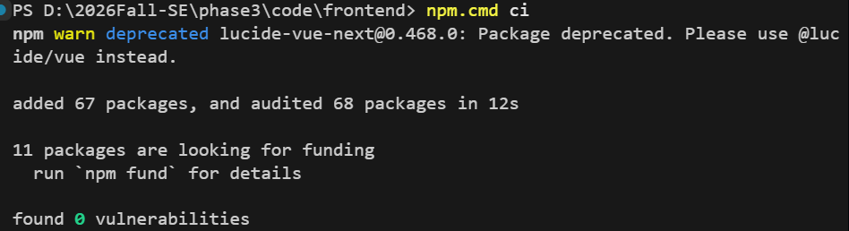
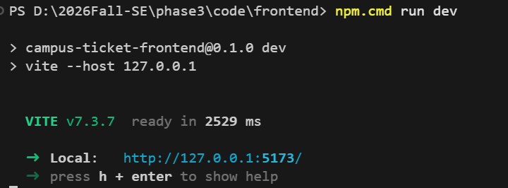
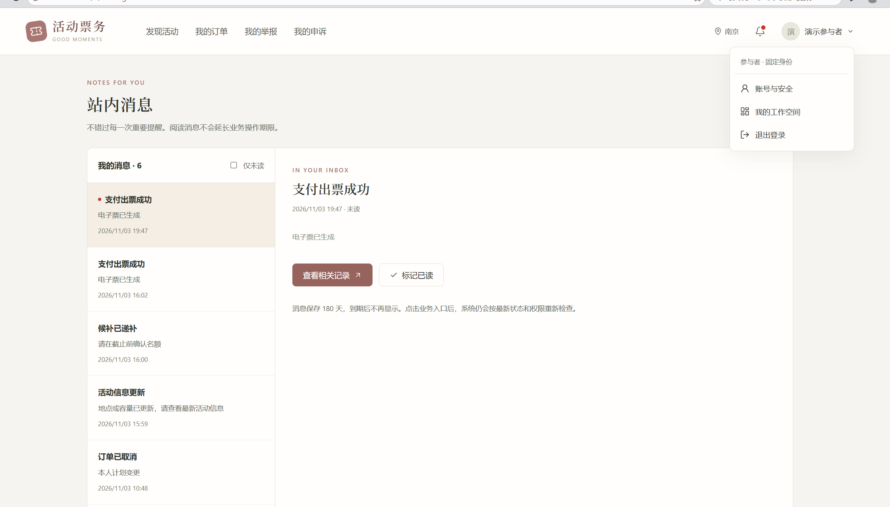
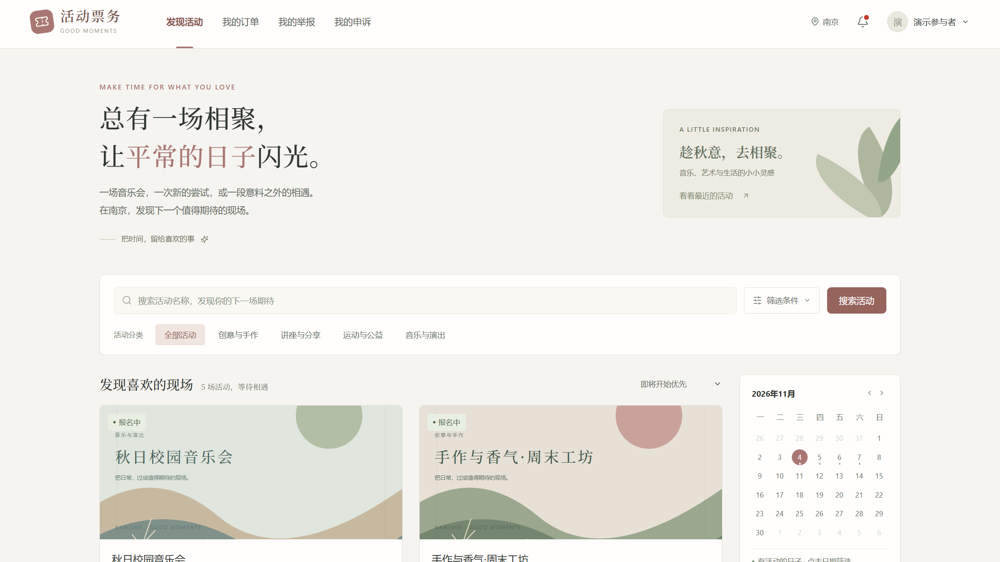
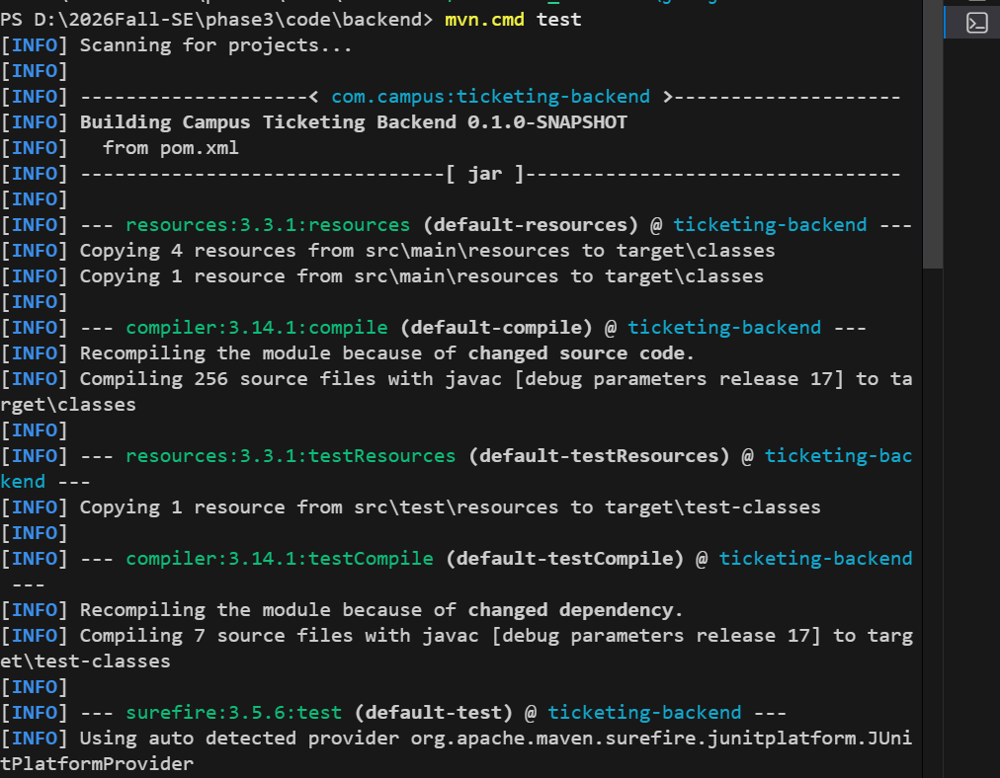
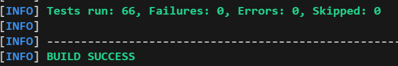
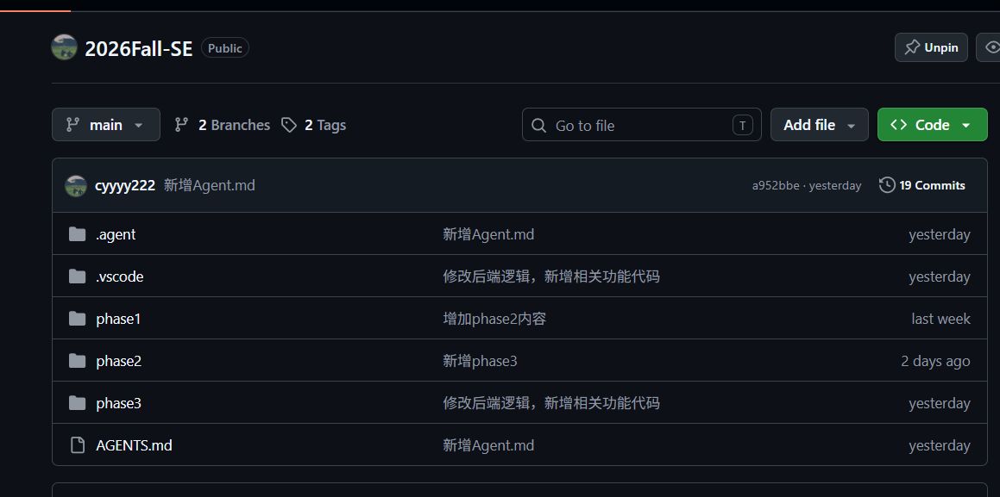
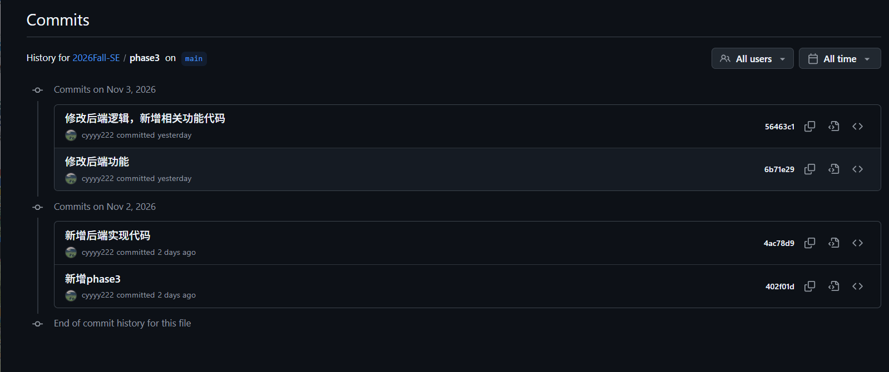

# 实验三：软件实现与构建 实验报告

| 项目 | 内容 |
| --- | --- |
| 学号 | 241220089 |
| 姓名 | 蔡杨杨 |
| 实验题目 | 活动票务与报名系统 |
| 代码仓库 | `2026Fall-SE`（GitHub） |
| 完成日期 | 2026-11-04 |


## 一、实验环境

| 类别 | 环境 |
| --- | --- |
| 操作系统 | Windows |
| JDK | Java 17（`D:\javajdk17`） |
| 后端 | Spring Boot 3.5.16、Maven 3.9.4 |
| 数据库 | MySQL 8.0.44 |
| 缓存 | Redis 5.0.14.1 |
| 前端 | Vue 3、TypeScript、Vite 7、Node.js 24.14 |
| 数据库访问 | Spring JDBC + 统一的 `RecordStore`/`JdbcRecordStore` |
| 代码管理 | Git + GitHub |

项目为桌面网页应用，前端开发地址为 `http://127.0.0.1:5173`，后端接口地址为 `http://127.0.0.1:8080`。Vite 将 `/api` 代理到后端，前后端分开运行。

## 三、根据 UML 图实现代码

### 3.1 设计依据

实现主要依据 `phase2/UML/` 下的 8 张 PlantUML 图：

| UML 图 | 用途 |
| --- | --- |
| 组件图 | 划分账号、活动、报名、支付、验票、统计、治理等模块 |
| 类图（一） | 账号、活动、场次、订单、票等核心领域对象 |
| 类图（二） | 举报、处罚、持久任务、消息、统计等治理对象 |
| 用例图 | 参与者、组织者、检票员、管理员四类角色的权限 |
| 活动状态图 | 草稿、待审、已发布、取消、下架、结束的生命周期 |
| 订单状态图 | 候补、递补待确认、未支付、已报名、已签到、退款、缺席等状态 |
| 报名支付时序图 | 报名、占位、候补、支付、出票的事务流程 |
| 验票/终止时序图 | 票号核对、确认签到、活动终止竞争的处理 |

同时参考了 `phase1` 的需求文档、`phase2` 的 UI 注记以及后续整理的 `phase3/docs/api.md`、数据库设计和需求追踪表。UML 是设计模型，最终以 API 契约、数据库结构和实际实现为准。

### 3.2 从 UML 到代码的转换方法

本项目不是用工具把 UML 一键生成完整系统，而是采用“模型设计 → 生成骨架 → 人工实现业务 → 测试与文档同步”的方式。

1. **按 UML 建立领域模型**

   类图中的类、属性、关联和多重性映射为 Java record 实体、数据库表、外键、唯一索引和可空字段。例如：

   - `User`、`Event`、`EventSession`、`Order`、`Ticket` 等映射为 `*Entity.java`；
   - 类之间的关联映射为 UUID 外键和聚合关系；
   - 状态字段映射为枚举和数据库 `CHECK` 约束。

2. **准备阶段生成代码骨架**

   `phase3/code/backend/tools/` 下有两个准备阶段生成器：

   - `prepare_schema.py`：根据表/字段规格生成 MySQL DDL、字段字典和不可变 Java 实体；
   - `prepare_http.py`：读取 `docs/api.md` 的规范路径，生成枚举、请求/响应 DTO，以及 `Controller → Service → 501 占位实现` 骨架。

   生成器只用于准备阶段。业务实现完成后，脚本开头已加入冻结保护，避免再次运行时覆盖手写代码：

   ```python
   raise SystemExit("Preparation generator is frozen after business implementation; ...")
   ```

3. **把状态图和时序图落实为用例逻辑**

   - 订单状态图 → `OrderStatus` 枚举、`OrderUseCases` 中的状态守卫、持久任务和条件更新；
   - 报名支付时序图 → `register`、`payment-attempts`、出票和通知同事务；
   - 验票时序图 → `previewTicket` 先鉴权再展示，`confirmCheckIn` 重新校验并保证唯一签到；
   - 活动状态图 → `EventStatus`、`EventUseCases` 的提交、审核、发布、取消和终止逻辑。

4. **把用例图和组件图落实为接口与页面**

   - 四类角色对应四组 Controller 权限和 Vue 路由；
   - 后端采用 `controller / service / service.core / dao` 分层；
   - 页面、侧栏和操作入口按角色显示；
   - 前端通过统一的 `src/api/client.ts` 和 `src/api/http.ts` 调用后端，不把请求逻辑散落在组件里。

5. **人工实现和持续验证**

   生成骨架之后，核心业务规则、事务、并发、幂等、权限、CSRF、异常处理、前端交互和后续新增规则均由人工实现和检查，并通过 `mvn test`、前端测试、类型检查、构建和真实接口联调验证。

### 3.3 UML 元素与代码的对应关系

| UML 元素 | 代码落点 |
| --- | --- |
| 类、属性、关联 | `entity/*Entity.java`、MySQL 表、DTO |
| 状态与迁移条件 | 枚举、`*UseCases` 中的状态检查、数据库约束、后台任务 |
| 时序图中的事务步骤 | Service 方法、事务边界、幂等键、行锁与条件唯一索引 |
| 参与者与用例 | Controller 路由、`@PreAuthorize`、Vue 路由与角色导航 |
| 组件边界 | 后端分层包结构、前端 `views/components/api/stores` |
| 界面注记 | Vue 页面、组件和 `styles/main.css` |

后续需求变更（例如跨活动改绑、周缺席处罚、举报规则、验票窗口等）没有回头修改 `phase2` 的 UML，而是同步到 `phase3/docs` 的 API、数据库和项目文档中；`phase2` UML 作为历史设计材料保留。

### 3.4 最终代码规模

统计范围为 `phase3/code` 下的源码，不包含 `node_modules`、`dist`、`target`、`.m2` 等依赖或构建产物。有效行数已剔除大部分空行和整行注释，Vue/TS/CSS 注释未完全剔除，因此为近似值。

| 类别 | 文件数 | 物理行 | 有效行（约） |
| --- | ---: | ---: | ---: |
| 后端主代码 Java | 256 | 16,215 | 14,552 |
| 后端测试 Java | 7 | 2,004 | 1,886 |
| 前端 Vue | 28 | 6,335 | 6,325 |
| 前端 TypeScript | 12 | 3,243 | 3,218 |
| 前端 CSS | 1 | 4,030 | 3,977 |
| 前端测试 TypeScript | 3 | 614 | 587 |
| SQL（建库脚本与迁移） | 5 | 774 | 698 |
| **合计** | **312** | **33,215** | **31,243** |

其中生产代码（后端主代码 + 前端 Vue/TS/CSS + SQL）约 **28,770 行**，测试代码约 **2,473 行**，已明显超过实验要求的 500 行。

项目规模概况：

- 后端 Java 文件：263 个（主代码 + 测试）
- 前端 Vue 文件：28 个
- 业务接口路由：99 条
- 数据库业务表：34 张
- 后端自动化测试：66 项
- 前端自动化测试：22 项

### 3.5 代码风格与质量

前端统一使用 Prettier 管理 Vue、TypeScript 和 CSS 格式，`npm.cmd run format:check` 已在提交前通过。后端 Java 代码按包和职责分层，统一使用 `Entity`、`Requests`、`Queries`、`Views` 等命名区分内部实体与对外模型，Controller 不承载核心业务，事务和业务规则集中在 Service/`service.core`。

项目未额外接入 Checkstyle 插件，主要通过编译、类型检查、自动化测试、统一命名和代码审阅控制质量；构建与测试结果见第五节。

## 四、大模型辅助软件开发

### 4.1 使用工具

本次实验主要使用了两种大模型辅助工具：

- Codex + GPT6.1-sol：用于阅读前期材料、整理开发契约、搭建工程骨架和主要业务流程；
- OpenCode + DeepSeek V4 Flash：用于后续界面改造、业务规则调整、问题排查、测试补充和文档维护。

### 4.2 使用方式

我没有直接把一句“生成整个系统”交给大模型，而是采用分阶段、持续反馈的方式：

1. **先整理需求和契约**：阅读 phase1、phase2 的需求、UML 和 UI 注记，整理后端模块、接口和数据结构；
2. **采用 spec-coding**：先确定三层结构、数据库字段、Redis 用途、接口参数和错误码，再进入实现；
3. **采用 TDD/回归验证**：先明确业务不变量，再补测试并运行，避免只完成正常流程；
4. **小步迭代**：先在一个页面验证视觉改造，认可后再推广到全站；
5. **按实际运行结果验收**：通过页面操作、接口响应、数据库状态和测试结果判断是否完成，而不是只看“代码已生成”；
6. **先方案后实施**：涉及业务规则变化时，先让大模型列出方案、比较影响，再选择并实现。

我的角色是需求提出、方案选择、规则确认和最终验收；大模型承担需求整理、代码实现、问题定位、测试编写和文档维护。

### 4.3 大模型帮助完成的主要工作

**Codex：建立开发基础并打通主要流程**

- 整理项目文档、`docs/api.md`、需求追踪表和后端接口映射；
- 使用 Vue、TypeScript、Vite 实现参与者、组织者、检票员和管理员的桌面页面；
- 搭建 Spring Boot 三层后端，包括 DTO、实体、参数校验、权限、会话、CSRF 和统一异常处理；
- 规划并接入 MySQL、Redis，编写建表 SQL、字段说明和 Redis 键约定；
- 实现账号注册、手机号验证码、密码找回、人工申诉、管理员审核改密和手机号换绑；
- 排查联调问题，补充测试和真实联调记录，并编写 `AGENTS.md` 统一后续 AI 协作规范。

**OpenCode：改善体验并调整业务规则**

- 全站可读性改造：放大字号、加深文字、统一控件和说明，同时保留莫兰迪风格；
- 账号与消息：检票账号跨活动改绑、重置密码后一次性展示临时凭据、重复用户名提示、未读消息红点；
- 活动与审核：组织者提出新类别、管理员审核创建类别、修复新建活动持续加载、时间改为分钟精度；
- 交易与检票：调整候补确认/支付期限、验票窗口，补充检票预览中的用户名、姓名、手机号和 ID；
- 举报、处罚与申诉：每周缺席自动限制、二次缺席预警、参与者申诉、管理员审核；
- 工程验证：补充回归测试、执行增量迁移、更新接口和数据库文档，并进行构建、浏览器检查、服务重启和健康检查。

### 4.4 大模型生成内容不符合预期时的处理

我主要通过“具体现象 + 明确期望 + 验证结果”来纠正，而不是只说“效果不好”。

- **描述可复现的问题**：例如未读消息为空仍显示红点、组织者新建活动一直转圈、检票账号不能换绑其他活动、时间报错难以理解。
- **补充期望行为**：明确红点只在有未读时显示；新建活动应进入编辑页；检票账号应能跨活动改绑；时间应允许分钟精度。
- **纠正需求理解**：例如“名称不能重复”需要区分登录用户名和展示姓名；手机号换绑只需验证新手机号；管理员保留创建其他管理员的能力。
- **要求先出方案**：涉及处罚、举报、申诉等规则时，先让大模型列出可选方案和影响，再由我选择。
- **检查文档与实现一致性**：业务规则变化后，要求同步 API、数据库、项目说明和测试，避免代码与文档冲突。
- **接受更合理的替代方案**：例如密码不能回查明文，改为“重置后一次性展示临时密码”，而不是降低安全规则。
- **以实际运行结果验收**：查看页面截图、接口返回、数据库迁移结果、测试报告和服务健康状态，确认不是“看起来完成”。

### 4.5 经验与反思

大模型显著减少了重复编码、跨文件修改、测试补充和文档整理的工作量，尤其适合把自然语言需求转成接口、实体、页面和用例。但模型不能替代需求判断和最终验收。

口语化需求容易产生歧义，例如“名称不能重复”需要明确是用户名还是展示姓名；模型也可能优先完成正常流程，忽略权限、时间边界、重复提交、空值和旧数据兼容。因此，需要给出明确的验收条件，并持续检查异常场景。

如果再次开展类似协作，我会为每项修改写清楚：目标、范围、关键业务规则、验收标准和数据库变更权限；每轮结束区分“已经实现”“已经验证”和“尚未验证”，并及时提交 Git 版本。

## 五、代码的编译与运行结果

### 5.1 前端

要求 Node.js 22.12 以上，本次环境为 Node.js 24.14。在 VS Code 中打开仓库，新建终端：

```powershell
cd D:\2026Fall-SE\phase3\code\frontend
npm.cmd ci
npm.cmd run dev
```

启动成功后访问 `http://127.0.0.1:5173/`。前端只在本机运行，未部署到公网服务器。





前端页面示例：





前端构建与检查命令：

```powershell
npm.cmd test
npm.cmd run build
npm.cmd run format:check
```

本次验证结果：前端 22 项测试通过，TypeScript 类型检查、Vite 生产构建和 Prettier 格式检查通过。

### 5.2 后端

后端需要本机 MySQL、Redis 正常运行。启动前先确认 8080 端口没有其他后端实例，避免 JAR 被占用或端口冲突。

```powershell
cd D:\2026Fall-SE\phase3\code\backend
$env:JAVA_HOME='D:\javajdk17'
& 'D:\maven\apache-maven-3.9.4\bin\mvn.cmd' test
& 'D:\maven\apache-maven-3.9.4\bin\mvn.cmd' package
& "$env:JAVA_HOME\bin\java.exe" -jar target/ticketing-backend-0.1.0-SNAPSHOT.jar --spring.profiles.active=local-connected --app.jobs.enabled=true --logging.file.name=backend-local.log
```

后端测试与编译结果：





本次验证结果：后端 66 项测试通过，`mvn package` 生成可执行 JAR；健康检查 `GET http://127.0.0.1:8080/api/system/health` 返回 200，MySQL 和 Redis 均为 `UP`。

常见问题：

- `Port 8080 was already in use`：已经有一个后端在运行，不要重复启动；
- `Unable to rename ...jar`：旧后端占用了 JAR，先停止 8080 上的后端再执行 `mvn clean package`；
- `jar 中没有主清单属性`：通常是 `repackage` 失败后留下的普通 JAR，重新执行完整的 `mvn clean package` 即可。

前后端都启动后，打开 `http://127.0.0.1:5173/` 即可使用系统。

## 六、Git 远程代码管理

项目使用 GitHub 托管，仓库中包含 `phase1`、`phase2`、`phase3` 及 `AGENTS.md` 等材料。开发过程中按功能阶段提交，保留需求、设计、实现和文档的演进记录。





## 七、总结

本次实验完成了从 UML 设计到可运行软件的实现：后端使用 Java 17 + Spring Boot，前端使用 Vue 3 + TypeScript + Vite，数据存储使用 MySQL 和 Redis。系统覆盖参与者、组织者、检票员和管理员四类角色，包含活动发布审核、报名候补、模拟支付退款、电子票与验票、名单统计、举报处罚和账号安全等流程。

实现过程中，大模型主要用于整理契约、生成骨架、编写页面和测试、排查问题；我负责需求判断、方案选择、规则确认和最终验收。通过这次实验，我体会到：大模型可以提高开发效率，但需求边界、异常场景、数据一致性和最终结果仍必须由开发者自己确认。
